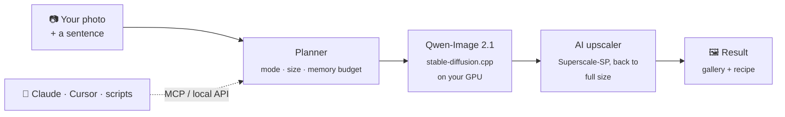
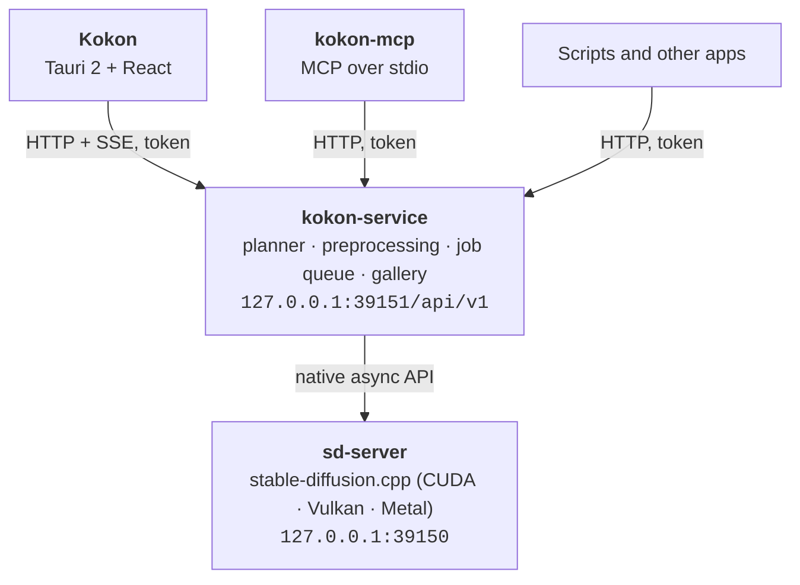

<p align="center">
  <picture>
    <source media="(prefers-color-scheme: dark)" srcset="assets/brand/logo/kokon-logo-white.svg">
    
  </picture>
</p>

<h3 align="center">Edit photos by describing the change, on your own computer.</h3>

<p align="center">
  Like Nano Banana, but private, offline and without limits. One installer for Windows, Mac and Linux:
  we pick the best open model and set it up for your GPU, you brush, type and get the result.
  No Python, no ComfyUI, no cloud.
</p>

<p align="center">
  <a href="https://github.com/GabrieleLozupone/kokon/releases/latest"></a>
  <a href="https://github.com/GabrieleLozupone/kokon/releases"></a>
  
  
  
  <br>
  
  
  
  
  <br>
  <a href="#use-it-from-your-ai-agent"></a>
  <a href="LICENSE"></a>
  <a href="https://github.com/GabrieleLozupone/kokon/stargazers"></a>
  <a href="https://mcpservers.org/servers/gabrielelozupone/kokon"></a>
</p>

<p align="center">
  <a href="https://kokon.app/">Website</a> ·
  <a href="#install">Install</a> ·
  <a href="#what-you-can-do">Features</a> ·
  <a href="#examples">Examples</a> ·
  <a href="#use-it-from-your-ai-agent">AI agents</a> ·
  <a href="#faq">FAQ</a> ·
  <a href="https://kokon.app/prompt-guide/">Prompt guide</a> ·
  <a href="docs/engineering-notes.md">How it works</a>
</p>

https://github.com/user-attachments/assets/8851c580-99b9-432a-82be-b6d42fa9a749

<p align="center"><a href="https://youtu.be/y2NAJkZ4vH0">Watch in 4K on YouTube</a> · <a href="https://youtu.be/qGiGXasJJNI">What's new in 0.10 (42 s)</a></p>

<p align="center">
  <a href="https://github.com/GabrieleLozupone/kokon/releases/latest"><picture>
    <source media="(prefers-color-scheme: dark)" srcset="assets/readme/download-windows-dark.svg">
    
  </picture></a>
  <a href="https://github.com/GabrieleLozupone/kokon/releases/latest"><picture>
    <source media="(prefers-color-scheme: dark)" srcset="assets/readme/download-macos-beta-dark.svg">
    
  </picture></a>
  <a href="https://github.com/GabrieleLozupone/kokon/releases/latest"><picture>
    <source media="(prefers-color-scheme: dark)" srcset="assets/readme/download-linux-beta-dark.svg">
    
  </picture></a>
  <br>
  <sub>Free and open source · about 12 GB of models downloaded on first run · nothing leaves your computer</sub>
</p>

---

## Like Nano Banana, but on your own computer

Cloud editors made "edit a photo with a sentence" normal, but they upload your photos and limit how much you
use them. Node-based tools run locally, but you build everything yourself. Kokon is simple **and** local:
we make the technical choices (model, files, steps, memory), you make the edits.

| | **Kokon** | ChatGPT, Gemini (Nano Banana) | Photoshop Generative Fill | ComfyUI |
| --- | :---: | :---: | :---: | :---: |
| Your photos stay on your computer | ✅ | ❌ uploaded | ❌ Adobe's cloud | ✅ |
| Free, no limits | ✅ it's your GPU | daily limits or subscription | subscription + credits | ✅ |
| Works offline | ✅ after setup | ❌ | ❌ | ✅ |
| Setup | one installer | an account | Creative Cloud | Python, nodes, model files |
| Who picks the model and settings | Kokon, tested for your GPU | the service | Adobe | you |
| Edit with one sentence | ✅ | ✅ | short prompt for a selection | after building a workflow |

Fair to say: cloud models run on data-center GPUs, so they can be faster and stronger on some edits. Kokon runs
Qwen-Image 2.1, which leads the open-weights image-editing rankings, on the computer you already have. You need
a 12 GB graphics card (8 GB in beta) or an Apple Silicon Mac, and the images are for non-commercial use because
of the model's license.

## Why Kokon

<table>
  <tr>
    <td width="33%" valign="top">
      <h3>✍️ Just describe it</h3>
      “Remove all the people from the beach.” “Make it golden hour.” Kokon picks the mode, the
      resolution and the memory settings for you. There are no sliders to learn. Only have a short
      idea? Prompt+ writes the detailed prompt for you, in any language.
    </td>
    <td width="33%" valign="top">
      <h3>🔒 Private by design</h3>
      Everything runs on your own GPU. No account, no uploads, no telemetry, no limits. After
      setup, Kokon only checks once a day for a new version (you can turn that off). A private
      mode keeps nothing at all.
    </td>
    <td width="33%" valign="top">
      <h3>📦 One installer</h3>
      A native app built on <a href="https://github.com/leejet/stable-diffusion.cpp">stable-diffusion.cpp</a>.
      No Python, no ComfyUI, no node graphs. The first run detects your graphics card or your
      Mac's memory and downloads the right model, then verifies it. Updates install in one click.
    </td>
  </tr>
  <tr>
    <td width="33%" valign="top">
      <h3>🎯 Edits that stay in place</h3>
      Paint over an area and choose Change, Remove, Replace or Add. Kokon shows the model
      exactly where to work, so the rest of the photo stays untouched.
    </td>
    <td width="33%" valign="top">
      <h3>🖼️ Full-size results</h3>
      Kokon keeps your photo's size and aspect ratio, and enlarges with an AI upscaler
      instead of blurry resizing. It also opens iPhone HEIC photos, HDR included.
    </td>
    <td width="33%" valign="top">
      <h3>🤖 Works with your AI agent</h3>
      A built-in MCP server and local HTTP API let Claude, Cursor or your own scripts create
      and edit images on your machine.
    </td>
  </tr>
</table>

## Examples

<p align="center">
  
  <br>
  <sub>One project, six steps in Kokon: generate the Colosseum, rebuild it out of pasta,
  add a tomato sauce river, generate the kitchen, combine the two, expand to 21:9.</sub>
</p>

Every image below was made by Kokon itself (no stock photos), first try with that seed. Prompts,
seeds and times are in [marketing/showcase/PROMPTS.md](marketing/showcase/PROMPTS.md).

| | |
| :---: | :---: |
| <br>**Remove** · paint the scooter · *“the red scooter”* | <br>**Replace** · *“Replace the yellow armchair with a deep green velvet sofa and hang an abstract painting above it”* |
| <br>**Relight** · *“Make it a snowy winter night, warm light glowing from the cabin windows”* | <br>**Restyle** · *“Turn it into a hand-painted watercolor illustration”* |
| <br>**Text** · *“Change the gold sign text to ‘KOKON CAFÉ’”* | <br>**Expand** · 40 % left and right · *“continue the rocky coastline and the turquoise sea”* |

## Install

**1. Download** from the [latest release](https://github.com/GabrieleLozupone/kokon/releases/latest):

- **Windows:** `Kokon_<version>_x64-setup.exe`. Run it. It installs for your user only, so you don't need
  administrator rights.
- **Mac (Apple Silicon, beta):** `Kokon_<version>_aarch64.dmg`. Open it and drag Kokon to
  Applications. The first time, macOS blocks it because the app is not notarized by Apple:
  open System Settings → Privacy & Security and click **Open Anyway**, or run one Terminal
  command if there is no such button ([details](#macos-says-kokon-cannot-be-opened)).
- **Linux (x86-64, beta):** `Kokon_<version>_amd64.deb` for Ubuntu, Debian and Mint, or
  `Kokon-<version>-1.x86_64.rpm` for Fedora. Install it with your package manager, which also
  pulls in the few libraries it needs:

  ```bash
  sudo apt install ./Kokon_<version>_amd64.deb      # Ubuntu 22.04+, Debian 12+, Mint 21+
  sudo dnf install ./Kokon-<version>-1.x86_64.rpm   # Fedora 40+
  ```

  For NVIDIA cards you need the proprietary driver (the CUDA runtime comes with Kokon). AMD and
  Intel cards use Mesa's Vulkan driver, installed on most desktops already. If apt prints
  "Download is performed unsandboxed as root", that's harmless (apt can't read your home
  folder); copy the .deb to `/tmp` first to avoid it.

**2. Set up models.** On first launch Kokon shows your graphics card (or your Mac's chip and
memory), recommends a preset and downloads everything it needs. The download resumes if it is
interrupted and every file is checked against its SHA-256 checksum. On a fast connection the
whole thing takes a few minutes, and the setup screen shows what Kokon can do while you wait.

**3. Edit.** Drop or paste a photo, describe the change and press <kbd>Enter</kbd>.

### Requirements

**Windows**

| | Minimum | Recommended |
| --- | --- | --- |
| **OS** | Windows 10 64-bit | Windows 11 |
| **GPU** | NVIDIA, 12 GB VRAM (RTX 3060 12 GB, 4070); 8 GB in beta (RTX 3060 Ti, RTX 5050 Laptop) · AMD / Intel 12 GB+ through Vulkan (beta) | NVIDIA, 16 GB+ VRAM (RTX 4080, 5070 Ti, 5080, 4090, 5090) |
| **RAM** | 16 GB | 32 GB |
| **Disk** | 15 GB free | 25 GB free on an SSD |
| **Time per image** <!-- RTX 5070 edit time not measured yet (text to image only, 10-11) --> | RTX 5070 12 GB: ~12 s per 1 MP image, ~42 s at native 2K (text to image) | RTX 5070 Ti 16 GB: ~24 s per edit at Balanced (1.5K), ~36 s for a new image at native 2K |

**Mac (beta)**

| | Minimum | Recommended |
| --- | --- | --- |
| **Chip** | Apple M1 or newer (Intel Macs are not supported) | M-series Pro, Max or Ultra (the GPU cores set the speed) |
| **macOS** | 15 Sequoia | latest |
| **Unified memory** | 16 GB: works, but slowly (lightest mode, about 1 megapixel) | 32 GB or more (also gets native 2K) |
| **Disk** | 15 GB free | 25 GB free |
| **Time per image** | About 4 minutes for a 1 MP image on a 16 GB M2 Pro | Faster on Max/Ultra chips with more memory |

**Linux (beta)**

| | Minimum | Recommended |
| --- | --- | --- |
| **Distribution** | x86-64: Ubuntu 22.04, Debian 12, Mint 21, Fedora 40 (or newer) | the latest Ubuntu LTS or Fedora |
| **GPU** | As on Windows: NVIDIA 12 GB (8 GB in beta) with the proprietary driver · AMD / Intel 12 GB+ through Vulkan (beta) | NVIDIA, 16 GB+ VRAM |
| **RAM** | 16 GB | 32 GB |
| **Disk** | 15 GB free | 25 GB free on an SSD |

Kokon measures your machine's speed with the first image and shows realistic time estimates
from then on.

> [!NOTE]
> NVIDIA cards run on the CUDA engine, the fastest and tested path. AMD and Intel cards use the
> **Vulkan engine (beta)**. First user report on AMD: an RX 9060 XT 16 GB on Windows made a 16:9
> 1080p image at Balanced in about 80 s (the first image after start, model loading included),
> with edits quicker after that. Intel is still untested, so please
> [report how it goes](https://github.com/GabrieleLozupone/kokon/issues).
> Vulkan is slower than CUDA, and its first image takes longer. Macs use the **Metal engine
> (beta)**, tested so far on a 16 GB M2 Pro. On Linux Kokon ships its own CUDA and Vulkan builds
> of the same engine, tested so far on an RTX 5070 Ti under WSL. Details in
> [docs/platforms.md](docs/platforms.md) and [docs/linux.md](docs/linux.md).

<details>
<summary><b>Model presets: what gets downloaded</b></summary>
<br>

The setup screen picks a preset from your VRAM. On a Mac the presets are named by unified
memory (16–24 GB Mac, 32–36 GB Mac, 48 GB Mac, 64 GB+ Mac), because the graphics part can use
only about two thirds of it and the text encoder shares the same memory. You can change the
preset later from Settings → Models → **Set up models…**

| Preset | Diffusion model | Text encoder (in RAM) | Download | Tested on real hardware |
| --- | --- | --- | --- | --- |
| 8 GB (beta) | Qwen-Image 2.1 Turbo Q4_K (4.1 GB) | Qwen3-VL 8B Q4_K_M | ~12 GB | by users: RTX 3060 Ti, RTX 5050 Laptop |
| 12 GB | Qwen-Image 2.1 Turbo Q4_K | Qwen3-VL 8B Q4_K_M | ~12 GB | ✅ RTX 5070 (12 GB) |
| 16 GB | Qwen-Image 2.1 Turbo Q4_K | Qwen3-VL 8B Q4_K_M | ~12 GB | ✅ RTX 5070 Ti |
| 24 GB | Qwen-Image 2.1 Turbo Q4_K | Qwen3-VL 8B Q4_K_M | ~12 GB | not yet |
| 32 GB+ | Qwen-Image 2.1 Turbo Q4_K | Qwen3-VL 8B Q8_0 (8.7 GB) | ~16 GB | not yet |

Every preset also gets stable-diffusion.cpp (the CUDA 12 build on NVIDIA, the Vulkan build on AMD and Intel, the Metal build on a Mac), the Qwen-Image 2.1 VAE with
[madebyollin's texture fix](https://huggingface.co/madebyollin/texture-fix-vae-for-qwen-image-2.1) (it removes the faint
2-pixel checkerboard of the original decoder; installs from 0.9.2 or earlier switch to it when you accept the update), the
Qwen3-VL vision projector and, on a PC, the Superscale-SP upscaler (67 MB). The image model is Qwen's
official 8-step [Qwen-Image 2.1 Turbo](https://huggingface.co/Qwen/Qwen-Image-2.1-Turbo) through
[DogukanUrker/Qwen-Image-2.1-Turbo-GGUF](https://huggingface.co/DogukanUrker/Qwen-Image-2.1-Turbo-GGUF);
the other sources are
[Qwen/Qwen3-VL-8B-Instruct-GGUF](https://huggingface.co/Qwen/Qwen3-VL-8B-Instruct-GGUF),
[madebyollin/texture-fix-vae-for-qwen-image-2.1](https://huggingface.co/madebyollin/texture-fix-vae-for-qwen-image-2.1) and
[Comfy-Org/Qwen-Image-2.1](https://huggingface.co/Comfy-Org/Qwen-Image-2.1) (the original VAE).

Files go to `%LOCALAPPDATA%\KokonData\sdcpp` (Mac: `~/Library/Application Support/KokonData/sdcpp`) by default. You can point the setup screen at an
existing stable-diffusion.cpp folder instead; files that are already there are kept.

Already have Qwen-Image 2.1 files, for example in ComfyUI? Choose **Use models I already have** in
the setup screen and pick the folder (such as `ComfyUI\models`): Kokon finds the image model, VAE,
text encoder and vision projector by their contents, as GGUF or safetensors in any quantization,
and downloads only the engine and any piece you don't have. Files stay where they are. Your own
files are not tested by Kokon; you can switch to the official files at any time in Settings → Models.

</details>

## What you can do

| You give Kokon | It does | |
| --- | --- | --- |
| A sentence | **Create** a new image | Aspect ratio from the prompt or the aspect menu |
| A photo + a sentence | **Edit** it | Original size and aspect ratio are kept |
| Several photos + a sentence | **Combine** them | Refer to them as “image 1”, “image 2”… and drag to reorder |
| A brushed area + an action | **Inpaint**: Change, Remove, Replace or Add | Remove needs no prompt |
| Dragged edges | **Expand** the photo (outpainting) | Or type pixel or percent values |
| Any result | **Upscale** to 2×, 4K, the source size or a custom width | With the upscaler model, in seconds |
| Any result | **Colour-grade** it with a LUT | Eight built-in looks (Neutral takes out a yellow cast) or your own `.cube` files, live preview with intensity |
| A short idea, in any language | **Prompt+** writes the detailed prompt first | You watch it being written; for edits it looks at your photo. Runs on the model Kokon already has: no extra download, a few seconds more |
| Your own LoRA files | **Apply them** to a project (beta) | Qwen-Image 2.1 LoRAs (`.safetensors`) loaded in Settings → LoRA, up to 3 at once, each with its strength |

**New to prompts?** The [prompt guide](https://kokon.app/prompt-guide/) shows good and bad prompts side by side, with real results.

<p align="center">
  
</p>

Every result can be edited again, varied, used as a reference, upscaled, saved, copied or
opened in Explorer, Finder or your file manager. A few things make that loop fast:

- **Before/after**: compare with Slider, Flicker or Changes, or hold <kbd>B</kbd> to see the original.
- **Undo/redo between versions** with <kbd>Ctrl</kbd>+<kbd>Z</kbd> / <kbd>Ctrl</kbd>+<kbd>Y</kbd> (<kbd>⌘</kbd> on a Mac).
  Undo returns to the version the current one came from, and nothing is ever deleted.
- **Gallery**: every image keeps its full recipe (prompt, seed, settings, pipeline) and reopens
  with one click. The recipe is also embedded in the PNG.
- **Clean up in one go**: press **Select** (or <kbd>Ctrl</kbd>/<kbd>⌘</kbd>-click, <kbd>Shift</kbd>-click
  for a range) to remove several projects or delete several gallery images at once.
- **Quality presets**: **Fast** (the default, ~1 MP), **Balanced** (~1.5K) and **Quality**
  (native 2K). All run Qwen's official 8-step Turbo model with its own schedule, so you never
  need to tune steps or guidance.

## How it works



The planner decides what kind of job your request is, picks a working size that fits your GPU
and runs a single diffusion pass. When the result has to be larger than what the model rendered,
it is enlarged with an AI upscaler instead of a plain resize. For brushed edits, Kokon marks the area on
a second reference image so the model knows exactly where to work. Without that, Qwen-Image 2.1
cannot see the mask.

With **Prompt+** on, the planner first asks the model's own text encoder (Qwen3-VL, already loaded
to read your prompt) to write a detailed English prompt, looking at your photo for edits. It runs
inside stable-diffusion.cpp, so there is no second language model in memory. The image then uses
that prompt, and the result keeps both yours and the written one.

### The engine

Kokon runs on [stable-diffusion.cpp](https://github.com/leejet/stable-diffusion.cpp) by leejet.
Prompt+ needed something it doesn't have: a way for the Qwen3-VL text encoder, already loaded for
the image, to write text. The easy route was a second language model next to it, but another 5 GB
model doesn't fit beside Qwen-Image 2.1 on 8–12 GB cards or on most Macs. So since 0.10 Kokon runs
its own build of stable-diffusion.cpp, from
[our fork](https://github.com/GabrieleLozupone/stable-diffusion.cpp/tree/kokon), on Windows,
macOS and Linux. It is upstream plus a few additions:

- **Text generation on the loaded text encoder:** a decoding loop with a KV cache, sampling, the
  chat template with image tokens, and a `/sdcpp/v1/text_gen` endpoint in sd-server. With greedy
  decoding it writes the same tokens as llama.cpp on the same GGUF.
- **Room on small cards:** while it writes, the diffusion model and the VAE wait in RAM if the GPU
  is short of memory, and come back in about half a second for the image. Prompt+ fits within
  8 GB (tested on an 8 GB-capped card).
- **Speed:** the decoding step is reused from token to token and, on NVIDIA, replayed as a CUDA
  graph: about 127 tokens/s on an RTX 5070 Ti (llama.cpp: 133–145), so a prompt takes 1–2 s.

The image side is upstream's code, and our changes leave its images bit-identical. We proposed
the text generation upstream ([#2155](https://github.com/leejet/stable-diffusion.cpp/issues/2155));
leejet prefers to keep text generation out of stable-diffusion.cpp, since llama.cpp already does
it, which is fair. So it lives in our fork, which we keep close to upstream's master. Kokon still
works with an official stable-diffusion.cpp release, just without Prompt+.

Want the details? The [engineering notes](docs/engineering-notes.md) cover the architecture,
the measured backend settings and the reasons behind each default.

## Use it from your AI agent

Kokon ships `kokon-mcp`, an [MCP](https://modelcontextprotocol.io) server. Register it once
with Claude Code:

```powershell
# Windows
claude mcp add --scope user kokon -- "$env:LOCALAPPDATA\Kokon\kokon-mcp.exe"
```

```bash
# Mac
claude mcp add --scope user kokon -- /Applications/Kokon.app/Contents/MacOS/kokon-mcp
```

Or, on either system with Node.js 22+, through [npm](https://www.npmjs.com/package/kokon-mcp)
(still needs the app installed):

```bash
claude mcp add --scope user kokon -- npx -y kokon-mcp
```

Then ask: *“Generate a hero image for this README and save it in docs/”* or *“Remove the
background clutter from screenshot.png”*. The app doesn't need to be open, because the MCP server
starts the engine on demand. The first call takes about a minute while the model loads.

**Tools:** `generate_image` · `edit_image` · `edit_images` · `inpaint_image` · `outpaint_image` · `upscale_image` · `get_image_info` · `get_generator_status`

<details>
<summary><b>Other MCP hosts (JSON config)</b></summary>
<br>

Project-scoped `.mcp.json`, or any host that takes the standard format (on a Mac the command is
`/Applications/Kokon.app/Contents/MacOS/kokon-mcp`):

```json
{
  "mcpServers": {
    "kokon": {
      "type": "stdio",
      "command": "C:\\Users\\<you>\\AppData\\Local\\Kokon\\kokon-mcp.exe",
      "args": []
    }
  }
}
```

Same thing from the command line:

```powershell
claude mcp add-json --scope user kokon '{"type":"stdio","command":"C:\\Users\\<you>\\AppData\\Local\\Kokon\\kokon-mcp.exe","args":[]}'
```

</details>

<details>
<summary><b>MCP behavior and safety</b></summary>
<br>

- Every result returns the absolute path of the saved file, its size, seed and generation metadata.
- Paths may be absolute or relative to the project (`CLAUDE_PROJECT_DIR`). Reads and writes are
  limited to the project folder, Kokon's output folder and folders listed in
  `QLS_MCP_ALLOWED_DIRS` (separated by semicolons). Existing files are never overwritten.
- Images are **not** sent back to the model by default; they stay on disk. Pass
  `include_preview: true` to include a small JPEG preview.
- `upscale_image` takes `scale` (default 2) or `width`/`height` (up to 8192 px).
- Progress is reported through MCP progress notifications. Claude Code's default tool timeout is
  30 minutes (`MCP_TOOL_TIMEOUT`).
- Without the desktop window open, the model is unloaded after 15 idle minutes (Settings → General).

</details>

<details>
<summary><b>Local HTTP API</b></summary>
<br>

Base URL `http://127.0.0.1:39151/api/v1`. Every call except `/ping` needs
`Authorization: Bearer <token>`, with the token from `%LOCALAPPDATA%\KokonData\service.json`
(Mac: `~/Library/Application Support/KokonData/service.json`).
Requests that carry a browser `Origin` header are refused.

```powershell
$i = Get-Content "$env:LOCALAPPDATA\KokonData\service.json" | ConvertFrom-Json
$h = @{ Authorization = "Bearer $($i.token)" }
Invoke-RestMethod -Method Post "http://127.0.0.1:$($i.port)/api/v1/generate" -Headers $h `
  -ContentType 'application/json' -Body '{"prompt":"a lighthouse at dusk, 16:9","quality":"fast"}'
```

| Method | Path | Purpose |
| --- | --- | --- |
| GET | `/ping` | Liveness (no auth) |
| GET | `/status` | Server state, model, GPU/VRAM, active job, queue |
| POST | `/generate`, `/edit`, `/inpaint`, `/outpaint`, `/upscale` | Simple operations; wait for the result unless `?wait=false` |
| POST | `/jobs` | Full request (see `GenerationRequest` in `planner.rs`) |
| GET | `/jobs/{id}`, `/jobs/{id}/wait?timeout=60` | Job status / long-poll |
| POST | `/jobs/{id}/cancel` | Cancel |
| POST | `/plan` | Dry run: resolved mode, working/output size, notes |
| GET | `/events` | Server-sent events (jobs, server, gallery) |
| GET | `/gallery`, `/gallery/{id}`, `/gallery/{id}/image` | Gallery |
| POST | `/image-info` | Size, aspect, type, embedded generation metadata |

Simple-operation fields: `prompt`, `image` / `images[]`, `mask`, `action`
(`edit|remove|replace|add`, inpainting), `width`, `height`, `aspect_ratio`, `quality`
(`fast|balanced|quality`), `seed`, `output_path`, `preserve_dimensions`, `private`,
`left/right/top/bottom` + `units` (`pixels|percent`) for outpainting, `scale` for upscaling.
Full requests (`/jobs`) also accept `"mode": "upscale"` with `"upscale": {"scale" | "width"/"height"}`.

</details>

## Privacy

Kokon makes only two kinds of network request:

- **Setup:** `github.com` for the stable-diffusion.cpp release (and the MoSR upscaler, if the copy
  that comes with the app is missing) and `huggingface.co` for the models and the other upscalers.
- **Update check:** at most once a day, the app fetches `latest.json` from this repository's
  latest GitHub release, a small file with the newest version number. Nothing about you or your
  images is sent. Turn it off on the welcome screen or in Settings → General. Updates are
  downloaded only when you click **Update**, and installed only if their signature matches the
  key built into the app.

Creating, editing, the gallery, the MCP server and the API talk to `127.0.0.1` only. Logs never
contain your prompts.

You can check this yourself. While you work, watch `Kokon`, `kokon-service` and `sd-server` in
Resource Monitor's Network tab on Windows (or run `Get-NetTCPConnection -OwningProcess <pid>`),
or with `lsof -i -P | grep -iE "kokon|sd-server"` on a Mac.

**Private mode** (the eye icon in the top bar) keeps images and prompts out of the gallery, the
output folder and the project list. They are deleted when you turn private mode off, close the
window, or restart the service. **Save as…** still writes a copy wherever you choose.

## How it compares

Against other local tools. Kokon does one thing: photo editing with the best open model we've tested
(today Qwen-Image 2.1), with nothing to set up. If you want full control over every node, ComfyUI is the
better tool.

| | **Kokon** | ComfyUI + Qwen workflow | Krita AI Diffusion | Other Qwen web UIs |
| --- | :---: | :---: | :---: | :---: |
| Install | One installer (`.exe` / `.dmg` / `.deb` / `.rpm`) | Python environment + nodes | Krita + plugin + ComfyUI | Python or ComfyUI |
| Picks size and memory settings for you | ✅ | ❌ | partly | partly |
| Brush edits the model can see | ✅ | depends on the workflow | ✅ | rarely |
| MCP server for AI agents | ✅ | community nodes | ❌ | ❌ |
| AMD / Intel GPUs | beta (Vulkan) | ✅ | ✅ | varies |
| Apple Silicon Macs | beta (Metal) | ✅ | ✅ | varies |
| Linux | beta (`.deb` / `.rpm`) | ✅ | ✅ | ✅ |
| Custom pipelines, node graphs | ❌ | ✅ | partly | ❌ |
| Painting and layers | ❌ | ❌ | ✅ | ❌ |

## FAQ

<details>
<summary><b>Windows says “Windows protected your PC”</b></summary>
<br>

SmartScreen shows this for new apps that don't have a download history yet. Click
**More info → Run anyway**. You can check the installer against the SHA-256 hash listed in the
release notes, or [build it yourself](#build-from-source).

If the installer **does nothing at all** (the cursor spins for a second, then no window and no
process), Windows blocked it silently, usually through Smart App Control on fresh Windows 11
installs. Right-click the downloaded `.exe` → **Properties**, tick **Unblock** at the bottom of the
General tab, click **OK** and run it again.

</details>

<details>
<summary id="macos-says-kokon-cannot-be-opened"><b>macOS says Kokon “cannot be opened”</b></summary>
<br>

Kokon is not notarized by Apple (that needs a paid Apple developer account), so macOS blocks
it the first time. You only do this once; in-app updates don't trigger it again.

1. Open Kokon. macOS says **“Kokon” Not Opened**: click **Done** (not *Move to Trash*).

   

2. Open **System Settings → Privacy & Security** and scroll down to **Security**. Next to
   “Kokon” was blocked to protect your Mac, click **Open Anyway**, then confirm with your
   password or Touch ID.

   

3. Open Kokon again and click **Open** in the last prompt.

If macOS instead only says **The application “Kokon” can't be opened**, with just an **OK**
button, and Privacy & Security shows no *Open Anyway*: open **Terminal** and run

```bash
xattr -dr com.apple.quarantine /Applications/Kokon.app
```

then open Kokon as usual. This removes the "downloaded from the internet" flag from Kokon only;
Gatekeeper stays on for everything else.

You can also [build it yourself](#build-from-source).

</details>

<details>
<summary><b>Do I need an internet connection?</b></summary>
<br>

Only to download the models. After that Kokon works fully offline. If you are online it checks
once a day for a new version, which you can turn off on the welcome screen or in Settings →
General.

</details>

<details>
<summary><b>Does it work on AMD or Intel GPUs, on a Mac or on Linux?</b></summary>
<br>

AMD and Intel: in beta. The setup screen installs stable-diffusion.cpp's Vulkan build for
them, which uses the graphics driver you already have. A user's RX 9060 XT 16 GB made a 1080p
image at Balanced in about 80 s (first image, model loading included); Intel Arc is still
untested, and integrated graphics are not supported. Please
[open an issue](https://github.com/GabrieleLozupone/kokon/issues) with your card and how it went.

Mac: yes, in beta, on Apple Silicon (M1 or newer) with macOS 15 Sequoia or newer. It runs on a
16 GB Mac in a lighter mode, but slowly (about 4 minutes per 1-megapixel image on an M2 Pro);
32 GB or more and a Pro, Max or Ultra chip are recommended. See the [requirements](#requirements)
and [docs/platforms.md](docs/platforms.md).

Linux: yes, in beta, on x86-64 with a `.deb` (Ubuntu, Debian, Mint) or an `.rpm` (Fedora). NVIDIA
cards run Kokon's own CUDA build of the engine, AMD and Intel cards its Vulkan build. A headless
server with the interface in your browser, and a Docker image, come next
([#15](https://github.com/GabrieleLozupone/kokon/issues/15)).

If the Kokon window stays blank on Linux, start it with `WEBKIT_DISABLE_DMABUF_RENDERER=1 kokon`
(a known WebKitGTK issue; Kokon already does this by itself on NVIDIA drivers).

</details>

<details>
<summary><b>My GPU has 8 GB. Can I still use it?</b></summary>
<br>

Yes, in beta since 0.9.3. Setup picks the 8 GB preset: the same files as the 12 GB one, with
smaller working sizes, so images are made at about 1 megapixel (then enlarged). Users report it
works on an RTX 3060 Ti and on an RTX 5050 Laptop, where an edit takes 1–2 minutes. The text
encoder runs from system RAM, so 16 GB of RAM or more is recommended. If you try it, please tell us
how it runs in an issue.

</details>

<details>
<summary><b>Can I use Kokon commercially?</b></summary>
<br>

Not with the default model. Kokon's code is open source (see [License](#license)), but the
image model has its own license: Qwen-Image 2.1 and its Turbo model are released under the
[Qwen Research License](https://huggingface.co/Qwen/Qwen-Image-2.1/blob/main/LICENSE), which allows **research and evaluation only, no commercial
use**. That includes selling or using commercially the images you make with it. For commercial
use, ask the Qwen team for a license (model-business@notice.qwencloud.com).

The Qwen3-VL text encoder is Apache-2.0. The default upscaler, Superscale-SP by Nmkd, is WTFPL,
and the experimental MoSR by Philip Hofmann is CC BY 4.0: both allow commercial use. The optional
UltraSharp upscaler is CC BY-NC-SA 4.0, non-commercial only.

</details>

<details>
<summary><b>iPhone photos (HEIC) and HDR</b></summary>
<br>

HEIC/HEIF photos open like any other image. On a Mac they are decoded by macOS itself. On
Windows, Microsoft's **HEIF Image Extensions** and **HEVC Video Extensions** must be installed.

iPhone photos with an HDR gain map (iOS 18+) show a **Keep HDR** switch in Advanced, which is on
by default. Edits of such photos are saved as **Ultra HDR JPEG**: Chrome, Edge, Android and
recent Apple systems show them in HDR, and every other viewer shows a normal JPEG. This needs
`ffmpeg` 7.1+ on PATH; without it the result is saved in SDR and the job's notes say why.

</details>

<details>
<summary><b>Which upscaler is used, and can I change it?</b></summary>
<br>

By default **Superscale-SP** by Nmkd (ESRGAN), downloaded by the setup screen; on a Mac,
**Lanczos**, because AI upscalers take minutes there (Superscale-SP: 5 min 45 s to enlarge a
1024×1024 image to 2048×2048 on an M2 Pro, against about a second). Pick another one
in the Advanced menu next to the prompt, or in Settings → Models; **Compare upscalers** there
shows each one on the same crops (a face, a JPEG photo, a night street, text, a landscape, a 4×
upscale):

- **Superscale-SP** (default): sharp and natural on most images; on JPEG photos and dark areas it
  can draw a faint grid.
- **MoSR** (experimental, 17 MB, comes with the app): the fastest, good for 4× upscales, but on
  clean images enlarged less than about 3× it draws a fine grid. Kokon contributed it to
  [stable-diffusion.cpp](https://github.com/leejet/stable-diffusion.cpp)
  ([pull request #2128](https://github.com/leejet/stable-diffusion.cpp/pull/2128), merged 2026-10-12).
- **UltraSharp** (optional download): very clean, but smooths skin into an artificial look and can
  invent lines. Non-commercial license.
- **Lanczos**: a plain resize, never invents anything.

**Upscaler strength** (0–100 %) mixes the upscaler's result with a plain resize, to tone down
texture it invents. Settings → Models also has **Shrink the image before upscaling**, which
gives the upscaler a smaller image, like the ones it was trained on.

</details>

<details>
<summary><b>Where are my images and settings stored?</b></summary>
<br>

| What | Windows | Mac |
| --- | --- | --- |
| Images | `%USERPROFILE%\Pictures\Kokon\<date>\` (configurable) | `~/Pictures/Kokon/<date>/` (configurable) |
| Settings | `%APPDATA%\Kokon\config.json` | `~/Library/Application Support/Kokon/config.json` |
| Gallery database, inputs, thumbnails, logs | `%LOCALAPPDATA%\KokonData\` | `~/Library/Application Support/KokonData/` |
| Models (default) | `%LOCALAPPDATA%\KokonData\sdcpp\` | `~/Library/Application Support/KokonData/sdcpp/` |
| API port and token | `%LOCALAPPDATA%\KokonData\service.json` | `~/Library/Application Support/KokonData/service.json` |

</details>

<details>
<summary><b>How do I uninstall it?</b></summary>
<br>

**Windows:** Settings → Apps → Installed apps → Kokon → Uninstall. The uninstaller asks whether to
delete the downloaded models and app data too (`%LOCALAPPDATA%\KokonData`).

**Mac:** drag Kokon from Applications to the Trash. To free the model space too, delete
`~/Library/Application Support/KokonData`.

Your images stay in your Pictures folder.

</details>

<details>
<summary><b>Something went wrong</b></summary>
<br>

If a download fails, the setup screen shows the file's download page and target folder so you
can fetch it by hand. For anything else, please
[open an issue](https://github.com/GabrieleLozupone/kokon/issues/new) with your GPU (or Mac model), driver
or macOS version and the log from `KokonData/logs` (see the table above).

</details>

## Roadmap

- [x] Create, edit, combine, brush edits, expand, upscale
- [x] First-run setup with GPU detection and verified, resumable downloads
- [x] MCP server and local HTTP API
- [x] Before/after, version undo, private mode, HEIC and HDR
- [x] macOS on Apple Silicon (beta, Metal)
- [x] One-click in-app updates on Windows, Mac and Linux
- [x] Linux (`.deb` and `.rpm`, beta)
- [x] Colour LUTs: built-in looks and your own `.cube` files
- [x] Qwen's official 8-step Turbo model for every preset
- [x] Prompt+: the prompt enhancer on the model Kokon already has (0.10.0)
- [x] Your own LoRA files, per project (0.10.0, beta)
- [ ] AMD and Intel GPUs through Vulkan (beta now; works on NVIDIA, to verify on AMD/Intel)
- [ ] Background removal and transparent cutouts
- [ ] Batch edits: one instruction for a whole folder
- [ ] Curated LoRAs tested with Kokon, installed in one click
- [ ] Headless server with the interface in the browser, then Docker
  ([#15](https://github.com/GabrieleLozupone/kokon/issues/15))
- [ ] Plugins for Krita, GIMP and Photoshop through the local API

Have an idea? [Start a discussion](https://github.com/GabrieleLozupone/kokon/discussions) or 👍 an existing one.

## Build from source

<details>
<summary><b>Requirements and commands</b></summary>
<br>

**Windows:** Rust (stable, MSVC), Node 22+, Visual Studio Build Tools and WebView2.

```powershell
npm install
cargo test -p qls-core            # core unit tests
npx vitest run                    # UI logic tests
cd mcp; npx vitest run; cd ..     # MCP tests (includes a stdio protocol test)
npx tauri dev                     # run the desktop app in development
powershell -ExecutionPolicy Bypass -File scripts\build-release.ps1   # installer
```

**Mac (Apple Silicon, macOS 15+):** Xcode Command Line Tools, Rust and Node 22+.

```bash
bash scripts/dev/mac-dev.sh --check   # check the prerequisites
bash scripts/dev/mac-dev.sh           # build and run the app in development
bash scripts/build-release-mac.sh     # Kokon.app + .dmg in dist-release/
```

**Linux (x86-64):** Rust (stable, via rustup), Node 22+ and Tauri's
[system packages](https://v2.tauri.app/start/prerequisites/#linux). Build on the oldest distribution
you want to support (releases are built on Ubuntu 22.04).

```bash
bash scripts/build-release-linux.sh --setup   # once: system packages
bash scripts/build-release-linux.sh           # .deb + .rpm in dist-release/
```

Publishing a release (signed in-app updates for every platform) is described in
[docs/releasing.md](docs/releasing.md).

</details>

<details>
<summary><b>Architecture</b></summary>
<br>



The Rust core (`crates/qls-core`) holds all the logic: geometry, image processing, planning,
the inference adapter, the job queue and the gallery. The service, the desktop app and the
MCP server are thin layers on top. See the [engineering notes](docs/engineering-notes.md)
for a module map and the backend facts each default is based on.

</details>

## Contributing

Bug reports, translations, example prompts and pull requests are all welcome. Issues tagged
[good first issue](https://github.com/GabrieleLozupone/kokon/labels/good%20first%20issue) are a good
place to start. Please run the tests above before opening a pull request.

## Responsible use

Kokon edits real photos. Don't use it to deceive, harass or impersonate people, or to make
images of someone without their consent. You are responsible for what you create and share.

## License

Kokon's source code is released under the [GNU Affero General Public License v3.0](LICENSE)
(AGPL-3.0-only). You can use, study, change and share it freely. If you distribute a modified
version, or offer one as a network service, you must publish its source under the same
license. The license covers the code, not the images you make with it.

Want to ship Kokon inside a closed-source product or service? A commercial license is
available: open a [discussion](https://github.com/GabrieleLozupone/kokon/discussions) or
contact the author.

Model weights and the upscaler are downloaded from their authors and keep their own licenses
(see the [FAQ](#faq)).

Kokon builds on [stable-diffusion.cpp](https://github.com/leejet/stable-diffusion.cpp) by
leejet (since 0.10 through [our fork](https://github.com/GabrieleLozupone/stable-diffusion.cpp/tree/kokon),
kept close to upstream), [Qwen-Image 2.1](https://huggingface.co/Qwen/Qwen-Image-2.1) and its Turbo model by the
Qwen team, DogukanUrker's Turbo GGUF conversions, [Tauri](https://tauri.app) and
the upscalers by Nmkd (Superscale-SP), Philip Hofmann (4xNomos2 MoSR) and Kim2091 (UltraSharp).
Thank you.

<p align="center">
  <br>
  
  <br>
  <sub>Made for people who would rather type a sentence than wire up a pipeline.</sub>
</p>
