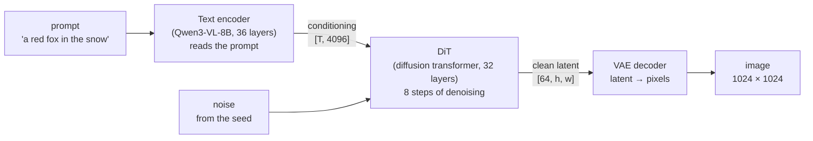
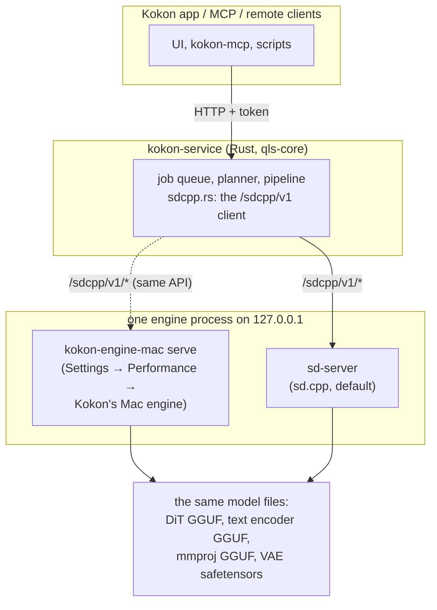
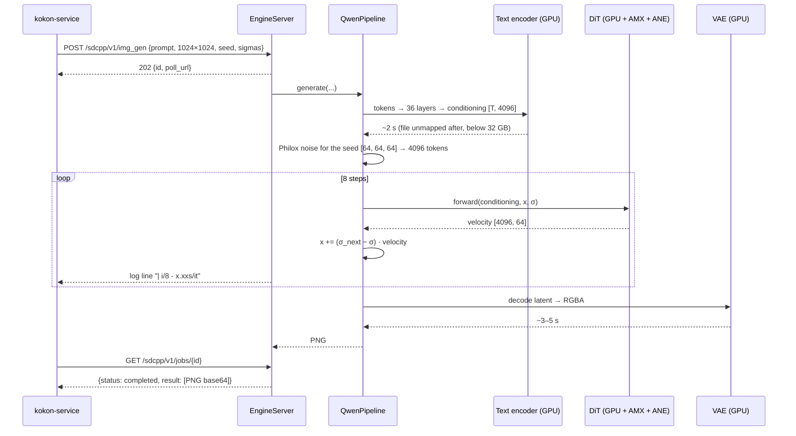
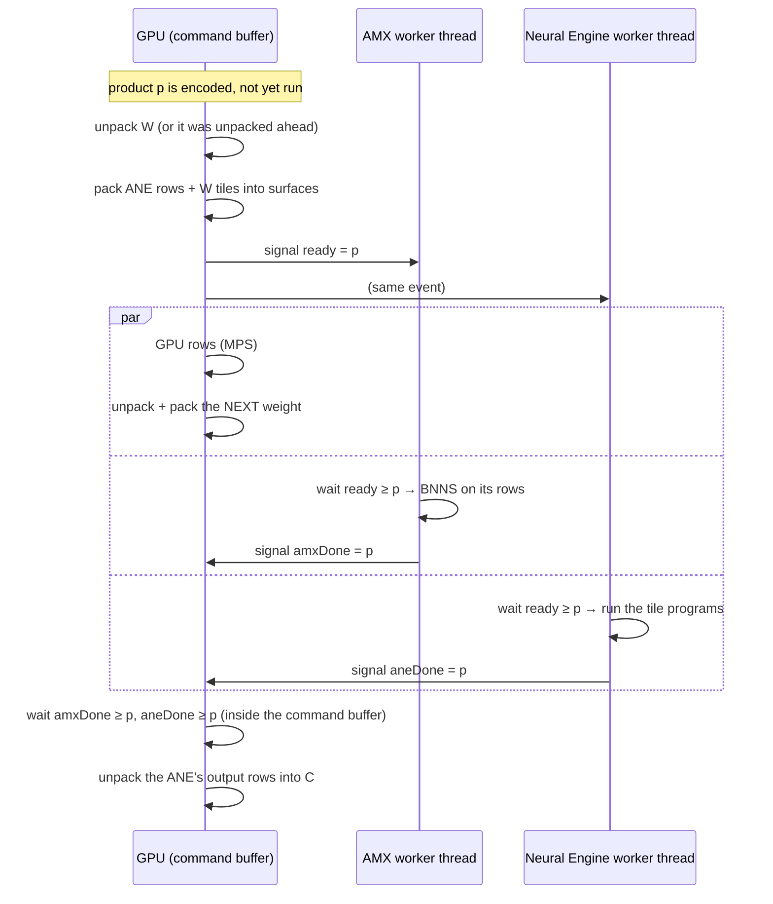
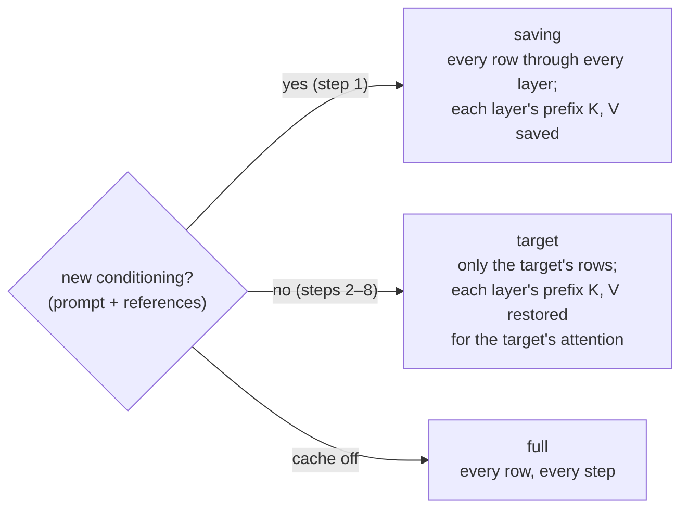
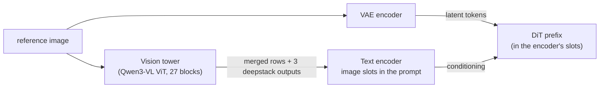
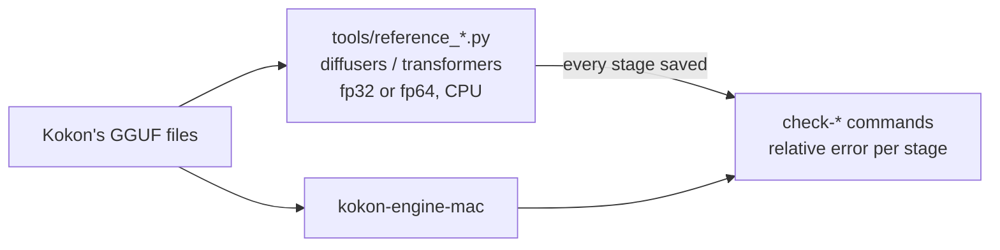

# Kokon's Mac engine, explained

This is the complete guide to `kokon-engine-mac`, Kokon's own engine for Apple Silicon. It explains what the engine
does, how every part works, why each choice was made, and how we know the result is right. It starts from zero: you
do not need to know diffusion models, GPUs or the Neural Engine to follow it. Each chapter says which source files it
describes, so you can read the code next to it.

The [README](../README.md) next to this folder is the lab notebook: every measurement, A/B run and check command, in the
order they were made. This guide is the explanation. When the two disagree, the code is right; please open an issue.

All timings in this guide come from one Mac, an **M2 Pro (19-core GPU, 16 GB, macOS 27)**, in October 2026, unless a
line says otherwise. Other Macs have not been measured by us yet; [Testing on your Mac](#27-measuring-a-mac-bench-and-the-tools)
says how to help.

### Who made this

**The idea and the specification are Gabriele Lozupone's.** Matrix products can be cut by rows and attention by
heads, so the engine should run them on the CPU (AMX), the GPU and the Neural Engine at once and reach the machine's
limit. To get there, each unit gets work in proportion to its throughput, so dead time disappears. The coordination
must respect the data dependencies: no unit should wait longer than it has to, and no unit should start a step before
the result it depends on is ready. And every operation runs at the precision its layer can take without losing
accuracy.

**The implementation and this guide were written by Claude (Anthropic), working in Claude Code** under Gabriele's
direction. That covers the Swift code, the Metal kernels, the Neural Engine programs, the balancing loop, the checks
against diffusers and transformers, and every measurement reported here. Gabriele ran the long benchmarks on his Mac,
reviewed the results and took the product decisions: which paths ship by default, the int8 cache on 16 GB Macs, what
stays opt-in. The Neural Engine technique and the three-unit split build on [Siliconed](https://github.com/gwenn-ha-dev/Siliconed);
see the [credits](#credits).

## Contents

**Part 1: the background**

1. [How to read this guide](#1-how-to-read-this-guide)
2. [What making an image means](#2-what-making-an-image-means)
3. [The arithmetic that takes the time](#3-the-arithmetic-that-takes-the-time)
4. [Number formats and quantized weights](#4-number-formats-and-quantized-weights)
5. [What is inside an Apple Silicon chip](#5-what-is-inside-an-apple-silicon-chip)
6. [Why Kokon has its own Mac engine](#6-why-kokon-has-its-own-mac-engine)

**Part 2: the engine, piece by piece**

7. [The big picture](#7-the-big-picture)
8. [The life of one image](#8-the-life-of-one-image)
9. [Reading the model files](#9-reading-the-model-files)
10. [The text encoder and the tokenizer](#10-the-text-encoder-and-the-tokenizer)
11. [The joint sequence and the block-causal mask](#11-the-joint-sequence-and-the-block-causal-mask)
12. [One DiT layer](#12-one-dit-layer)
13. [Three units on one product](#13-three-units-on-one-product)
14. [The Neural Engine in detail](#14-the-neural-engine-in-detail)
15. [The balancing loop](#15-the-balancing-loop)
16. [Attention](#16-attention)
17. [Moving fewer bytes: fp16 and fused kernels](#17-moving-fewer-bytes-fp16-and-fused-kernels)
18. [The prefix K/V cache](#18-the-prefix-kv-cache)
19. [Memory on a 16 GB Mac](#19-memory-on-a-16-gb-mac)
20. [The VAE](#20-the-vae)
21. [Edits with reference images](#21-edits-with-reference-images)
22. [Brushed edits and extending an image](#22-brushed-edits-and-extending-an-image)
23. [Prompt+: writing text](#23-prompt-writing-text)
24. [Seeds and noise](#24-seeds-and-noise)
25. [The server and the app](#25-the-server-and-the-app)
26. [Per-chip paths](#26-per-chip-paths)

**Part 3: trust, limits and reference**

27. [Measuring a Mac: bench and the tools](#27-measuring-a-mac-bench-and-the-tools)
28. [How we know it is right](#28-how-we-know-it-is-right)
29. [Tried and not kept](#29-tried-and-not-kept)
30. [Compared with sd.cpp](#30-compared-with-sdcpp)
31. [What is specific to Qwen-Image 2.1](#31-what-is-specific-to-qwen-image-21)
32. [Every switch](#32-every-switch)
33. [Source map](#33-source-map)
34. [Glossary](#34-glossary)

---

# Part 1: the background

## 1. How to read this guide

- **Part 1** explains the ideas the engine is built on. Skip it if you know diffusion models and Apple's hardware.
- **Part 2** follows the code. Chapters 8 and 13 are the heart: read them first if you only have ten minutes.
- **Part 3** is for checking, comparing and changing the engine.

Conventions:

- `[m, k]` is a matrix of m rows and k columns. A row is one token (one piece of the image or of the text).
- `C = A · W` is a matrix product: A holds the activations (what flows through the model), W the weights (what was
  learned).
- "1024²" means a 1024 × 1024 pixel image, about 1 megapixel (1 MP).
- `KOKON_SOMETHING=0` is an environment variable that switches a feature off. They exist so every choice can be
  measured against its alternative. [Chapter 32](#32-every-switch) lists them all.

## 2. What making an image means

Qwen-Image 2.1 is a **diffusion model**. It does not paint an image in one go. It starts from pure noise and removes a
little noise at each step until an image is left. Kokon uses the **Turbo** version, which needs only **8 steps**.

The model has three parts:



- **The text encoder** turns the prompt into numbers: one row of 4 096 numbers per token. These rows are the
  *conditioning*, what the image must match.
- **The DiT** does the denoising. It works on a **latent**, a small compressed picture: 64 numbers per cell, one cell
  per 16 × 16 pixels. A 1024² image has a 64 × 64 latent, so **4 096 latent tokens**.
- **The VAE decoder** expands the final latent into pixels.

Each of the 8 steps is one full run of the DiT, called one **evaluation**. The DiT predicts a *velocity*: the direction
from the current noisy latent towards a clean one. The step moves the latent along it:

```
x  ←  x + (σ_next − σ) · velocity        (flow Euler, one line per step)
```

σ (sigma) is the noise level: 1 at the start (pure noise), 0 at the end. Turbo's 8 sigmas are fixed:
`1.0, 0.978, 0.954, 0.927, 0.895, 0.845, 0.705, 0.415`, then `0`.

**Where the time goes.** At 1024², one DiT evaluation is about 57 TFLOP (57 million million multiply-adds). Eight of
them dwarf everything else: the text encoder takes about 2 s, the VAE about 3–5 s, the 8 steps about 60 s.
So almost all the work of this engine is about making one DiT evaluation fast.

## 3. The arithmetic that takes the time

A DiT layer is mostly **matrix products**. For example, the layer's "query" projection multiplies every token's 4 096
numbers by a 4096 × 4096 weight:

```
        A  [4096 tokens × 4096]     ·     W  [4096 × 4096]     =     C  [4096 tokens × 4096]
   each output number is a sum of 4 096 multiplications
```

Each layer has seven such products (q, k, v, out; and in the MLP: gate, proj, out, two of them 3× wider) plus the
**attention**, where every token looks at every other token. Products are about 60–70 % of an evaluation, attention
most of the rest.

The key fact for the whole engine: **each row of C depends only on the same row of A.** Row 17 of the output needs row
17 of the input and all of W, nothing else. So the rows of one product can be computed by different processors at the
same time, and the result is exactly the same as if one processor did them all. [Chapter 13](#13-three-units-on-one-product)
is built on this.

Attention has a similar property per **head**: the 4 096 numbers of a token are 32 heads of 128, and each head's
attention is independent of the others.

## 4. Number formats and quantized weights

Numbers in a computer have a fixed size. The size decides how precise they are and how many bytes must be moved:

| Format | Bytes | Precision | Largest value | Used here for |
|---|---|---|---|---|
| fp32 | 4 | ~7 digits | 3.4 × 10³⁸ | activations, sums, the VAE, the reference path |
| fp16 | 2 | ~3 digits | **65 504** | weights and activations fed to products, attention operands, the Neural Engine |
| bf16 | 2 | ~2 digits | 3.4 × 10³⁸ | what most tools run models in (not used here) |
| int8 | 1 | 255 levels | 127 | an opt-in Neural Engine path, the prefix cache on 16 GB |

fp16 has two traps the engine must avoid: values above 65 504 become infinity (**overflow**), and values below about
0.00006 lose precision; the Neural Engine turns them into zero (**flush**). [Chapter 14](#14-the-neural-engine-in-detail)
shows how the engine scales numbers to stay inside the safe range.

**Quantized weights.** The DiT has about 7 billion weights. In fp16 that would be 14 GB. Kokon downloads it in
**GGUF** files where the weights are *quantized*: stored in groups with a few bits each plus a scale. The main format is
**Q4_K**: blocks of 256 weights, each block split into 8 groups of 32, each group with its own 6-bit scale and offset,
each weight 4 bits. About 4.5 bits per weight, so the DiT file is ~4.2 GB.

```
Q4_K block (144 bytes = 256 weights):
  d, dmin (fp16)  │  12 bytes: 8 scales + 8 mins (6 bits each)  │  128 bytes: 256 × 4-bit codes
  weight = d · scale_g · code − dmin · min_g          (g = which group of 32 it is in)
```

No unit can multiply Q4_K directly. So before each product the weight is **unpacked** (dequantized) into fp16. This is
done again for each product, because keeping all weights unpacked would need 14 GB on top of everything else.

The file Kokon ships for this engine is unsloth's Qwen-Image 2.1 Turbo **Q4_K_M**: mostly Q4_K, with some Q5_K
(attention), Q6_K and Q8_0 (input and output layers). The engine reads F32, F16, BF16, Q4_0, Q8_0, Q4_K, Q5_K and Q6_K.

## 5. What is inside an Apple Silicon chip

An M-series chip has three units that can multiply matrices, all on the same piece of silicon:

```
┌───────────────────────────── one Apple Silicon chip ─────────────────────────────┐
│                                                                                  │
│   ┌──────────────┐     ┌────────────────────────┐     ┌──────────────────────┐   │
│   │     GPU      │     │          CPU           │     │    Neural Engine     │   │
│   │ (19 cores on │     │ performance cores +    │     │       (ANE)          │   │
│   │  the M2 Pro) │     │ AMX matrix unit        │     │  16 cores, fp16      │   │
│   │  Metal, MPS  │     │ Accelerate (BNNS, BLAS)│     │  reached via Core ML │   │
│   └──────┬───────┘     └───────────┬────────────┘     └──────────┬───────────┘   │
│          │                         │                             │               │
│   ═══════╧═════════════════════════╧═════════════════════════════╧═══════════    │
│                     unified memory: one RAM, all three read it                   │
└──────────────────────────────────────────────────────────────────────────────────┘
```

- **The GPU** is programmed with **Metal** (our own kernels, written in the Metal Shading Language) and **MPS**
  (Metal Performance Shaders, Apple's tuned matrix products). M5 GPUs also have matrix units in each core ("neural
  accelerators"), reached through Metal 4's tensor operations.
- **The AMX** is a matrix unit attached to the CPU's performance cores. There is no public instruction set for it;
  Apple's **Accelerate** library (BNNS and BLAS) uses it.
- **The Neural Engine** is a separate processor for neural networks, very fast in fp16. Apple gives only one public
  door to it: **Core ML**, which runs model files. [Chapter 14](#14-the-neural-engine-in-detail) explains how the
  engine uses Core ML for single matrix products.

**Unified memory** is what makes this engine possible. On a PC, the graphics card has its own memory, and data must be
copied over the PCIe bus to reach it. On a Mac, the GPU, the CPU and the Neural Engine read the same RAM. A buffer the
GPU writes can be read by the AMX one microsecond later, at the same address, with no copy. So three units can work on
one product.

Measured alone on Qwen's product shapes (M2 Pro, `probe`, 4 096 rows):

| Product (k × n) | GPU fp32 (MPS) | AMX fp32 | Neural Engine fp16 | All three, cut by rows |
|---|---|---|---|---|
| 4096 × 4096 (q, k, v, out) | 5.1 TFLOP/s | 1.7 | 7.4 | 11.0 |
| 4096 × 12288 (gate, proj) | 5.1 | 1.9 | 7.4 | 11.5 |
| 12288 × 4096 (MLP out) | 4.8 | 1.6 | 7.4 | 9.4 |

The Neural Engine alone beats the GPU on these shapes, and the three together are more than twice the GPU alone.

The limit: the three units share **one memory bus and one power budget**. When all three run, each is slower than
alone (the AMX runs at about half its solo rate). This shapes many choices below: when the units are already busy,
what pays is moving fewer bytes, not more parallelism.

## 6. Why Kokon has its own Mac engine

On Windows and Linux, Kokon runs images with **sd.cpp** (stable-diffusion.cpp), through its server `sd-server`. On a
Mac, sd.cpp uses the GPU through ggml's Metal backend. That is all it uses.

The measurement that started this engine (M2 Pro 16 GB, 1024² text to image, 8 steps, October 2026):

| Engine | Time for one 1024² image |
|---|---|
| Kokon's sd.cpp (Metal) | **276 s** (27.4 s per step) |
| mflux 0.23, 4-bit (MLX) | 158 s |
| Siliconed 0.14 (GPU + AMX + Neural Engine) | 94.5 s |
| **this engine today** | **~64–67 s** |

sd.cpp was compute-bound at about 35 % of the GPU's peak, with the AMX and the Neural Engine idle. A rule was set
before measuring: if another approach went under ~2.5 minutes per image, a Mac engine was worth writing.
[Siliconed](https://github.com/gwenn-ha-dev/Siliconed) (Apache-2.0), an app that runs Qwen-Image 2.1 on all three
units, showed it could be done. Its techniques for the Neural Engine and the three-unit split were read and
**written again here** (no fork, no dependency); the [credits](#credits) say exactly what came from it.

The decisions taken then, and still in force:

- **One model only: Qwen-Image 2.1 Turbo.** Kokon picks one model at a time; writing each layer by hand for one model
  is what makes the speed possible ([chapter 31](#31-what-is-specific-to-qwen-image-21)).
- **The same files.** The engine reads the GGUF and safetensors files Kokon already downloads for sd.cpp. Nothing is
  converted or downloaded again.
- **The same API.** The engine answers sd-server's `/sdcpp/v1` API, so the app, the service, remote access and the MCP
  server do not change.
- **sd.cpp stays.** It is the default, the fallback on Macs and the engine on every other platform. The Mac engine is
  opt-in and experimental.
- **Swift.** Metal, MPS, MPSGraph, Core ML and Accelerate are native there. The engine is a Swift package
  ([Package.swift](../Package.swift)): a library `KokonEngine` and a command-line tool `kokon-engine-mac`.

---

# Part 2: the engine, piece by piece

## 7. The big picture



Inside `kokon-engine-mac`, the parts and the units they run on:

| Part | Source | Runs on |
|---|---|---|
| HTTP server, jobs, logs | `EngineServer.swift`, `HTTPServer.swift` | CPU |
| GGUF and safetensors readers | `GGUF.swift`, `Safetensors.swift` | CPU (files mapped, never copied) |
| Weight unpacking | `GPUDequant.swift`, `Kernels/dequant.metal` | GPU |
| Tokenizer | `QwenTokenizer.swift` | CPU |
| Text encoder | `QwenTextEncoder.swift`, `Kernels/text.metal` | GPU |
| Vision tower (edits) | `QwenVisionTower.swift`, `Kernels/vision.metal` | GPU |
| DiT | `QwenDiT.swift`, `Kernels/dit.metal`, `Kernels/attention.metal` | GPU + AMX + Neural Engine |
| Three-unit split | `Coexecution.swift`, `AttentionSplit.swift`, `Balancer.swift`, `Kernels/ane.metal` | all three |
| VAE encoder and decoder | `QwenVAE.swift`, `QwenVAEEncoder.swift`, `Kernels/vae.metal` | GPU (MPSGraph + kernels) |
| Prompt+ | `QwenTextGeneration.swift`, `Kernels/decode.metal` | GPU |
| The image loop | `QwenPipeline.swift`, `Noise.swift` | CPU drives, GPU works |

## 8. The life of one image

A 1024² text-to-image request, from the moment the service sends it:



Typical times (M2 Pro 16 GB, through the API, 1024²): first image ~67 s, next ones ~64 s, peak memory ~5 GB.
The steps: step 1 ~8.4 s (it also fills the prefix cache, [chapter 18](#18-the-prefix-kv-cache)), steps 2–8
~7.3–7.7 s each.

What happens inside **one step**, at the level of the DiT ([chapter 12](#12-one-dit-layer)):

```
for each of 32 layers:
    LN + modulation      ┐
    q, k, v products     │  ← split by rows: GPU + AMX + Neural Engine
    q/k norm + RoPE      │
    attention            │  ← split by heads: GPU + CPU
    out product          │  ← split by rows
    residual + LN        │
    gate, proj products  │  ← split by rows
    SwiGLU               │
    MLP out product      ┘  ← split by rows
    (the layer's command buffer is committed; a cancel stops here)
final LN, proj_out → velocity
balancing loop reads the timeline, sets the next step's shares
```

## 9. Reading the model files

*Source: `GGUF.swift`, `MetalContext.swift`, `Arena.swift`, `GPUDequant.swift`, `Kernels/dequant.metal`,
`Quant.swift`, `Safetensors.swift`.*

### The file is mapped, never copied

`GGUFFile` opens the file and maps it into memory with `mmap` (read-only). Reading the header gives every tensor's
name, shape, type and offset. The tensor data itself is never read into a separate array: the engine uses pointers
into the mapping. macOS loads the pages from disk the first time they are touched, and may drop them again when memory
is short (they can always be read back from the file).

The GPU sees the same bytes. `MetalContext.buffer(for:in:)` wraps the page-aligned window of the file that holds a
tensor in a Metal buffer with `makeBuffer(bytesNoCopy:)`: no copy, the GPU reads the file's pages directly. After
each use these windows are released (`context.release(file)`), so an idle engine holds the weights only as file cache,
which macOS can reclaim, not as wired memory.

### The working memory: one arena

`Arena` is one large anonymous mapping, seen by the CPU as a pointer and by the GPU as one shared buffer. Every
working tensor of the DiT is a **slice** of it. A DiT row (4 096 fp32 values) is exactly 16 KB, one memory page, so
any range of rows is page-aligned: APIs that take no offset (MPSGraph) can get their own buffer over it without a copy.

### Unpacking on the GPU, just in time

Before each product, `GPUDequant` encodes a Metal kernel that unpacks the weight from Q4_K (or Q5_K, Q6_K, Q8_0…)
into a **reserve**, a slice big enough for the largest weight (4096 × 12288). The kernels use ggml's formulas
(`dequantize_row_*`) and are checked value for value against the CPU version (`Quant.swift`, `QuantTests`), which is
itself checked against `gguf-py`.

Three details:

- **Transposed output.** A Linear weight is stored `[out, in]`. The kernel writes it as `[in, out]` (`[k, n]`), the
  layout MPS multiplies without a transpose (2× faster on large K).
- **fp16 output** (the default): half the bytes written and then read by every unit.
- **Why the GPU, not the CPU.** Siliconed unpacks on the CPU. Here the CPU's performance cores are needed by the AMX,
  so the GPU does it, in a few milliseconds (a 4096 × 12288 Q4_K weight: 1.1 ms to fp16).

### Two reserves: unpacking the next weight during this product

There are **two reserves**. While the units multiply with the weight in reserve 0, the GPU already unpacks the next
weight into reserve 1 (`linear(next:)` → `ahead`). The GPU is the only unit that unpacks, but it does so while the AMX
and the Neural Engine are still working on their rows, so the time is hidden.

```
time →
GPU    │ unpack W_q │ GPU rows of q ··· │ unpack W_k (reserve 1) │ GPU rows of k ···
AMX    │            │ AMX rows of q ···························· │ AMX rows of k ···
ANE    │            │ ANE rows of q ···························· │ ANE rows of k ···
```

### Fused weights read as two views

unsloth's files use ComfyUI's layout, where each block's MLP `gate` and `proj` weights are fused into one
`img_mlp.gate_up` tensor `[2 × 12288, 4096]`. `QwenDiT.weight(_:)` returns each half as a **view**: the same bytes,
starting at the right row (a quantized row is contiguous). Nothing is copied.

### The VAE file

The VAE is a safetensors file (bf16, Wan 2.2 tensor names). `Safetensors.swift` maps it the same way. Its weights are
widened to fp32 once, 8 at a time on every core, straight into their buffers ([chapter 20](#20-the-vae)).

## 10. The text encoder and the tokenizer

*Source: `QwenTokenizer.swift`, `QwenTextEncoder.swift`, `Kernels/text.metal`.*

The text encoder is the text part of **Qwen3-VL-8B**: 36 transformer layers, 32 query heads and 8 key/value heads of
128, hidden size 4 096. It is a language model; here it only *reads*.

**The tokenizer** is Qwen's byte-level BPE, rebuilt from the encoder GGUF's metadata (`tokenizer.ggml.*`), doing what
Hugging Face's `tokenizers` does:

1. Special tokens (`<|im_start|>`, `<|image_pad|>`…) are split out first, longest match first.
2. Each piece between them: Unicode NFC, Qwen2's split regex, bytes mapped to GPT-2's printable characters.
3. BPE merges by rank.

It is checked token for token against the official processor on 42 cases (accents, CJK, emoji, decomposed Unicode,
special tokens inside the text).

**The template** is diffusers' `prompt_template_t2i`:

```
<|im_start|>system
Comprehend and analyze the provided prompt.<|im_end|>
<|im_start|>user
{prompt}<|im_end|>
<|im_start|>assistant
```

**The forward pass** runs on the GPU, fp32 activations, the same pattern as the DiT: each GGUF weight unpacked just
before its product, MPS for the products, our kernels for RMSNorm, RoPE (θ = 5 · 10⁶), causal attention and SwiGLU.

**The output** is the hidden state of the *last layer before the final norm* (diffusers hooks that norm away), with the
system message's first 14 tokens dropped. That is the conditioning, `[T, 4096]`. A short prompt is ~32 rows.

Timing: 0.45 s for 37 tokens, 0.8 s for 144 once the file is in memory. Most of the ~2 s seen per image is opening and
paging in the 5 GB file, which is not kept between images below 32 GB of memory ([chapter 19](#19-memory-on-a-16-gb-mac)).

## 11. The joint sequence and the block-causal mask

*Source: `QwenSequence.swift`.*

The DiT does not process the text and the image separately. It puts them in **one sequence** of rows:

```
text to image, 1024²:

 rows:   0 ............ 31 │ 32 ................................................ 4127
         text (32 rows)    │ target: the 4 096 latent tokens being denoised
         ── prefix ──      │ ── target ──

an edit with one reference image:

         text │ reference image's tokens │ more text │ target
         ───────────── prefix ────────────────────── │ target
```

The rules come from diffusers' `QwenImage21Transformer2DModel.forward`:

- The text encoder's rows go in order. Where the encoder had an image slot (an edit), that slot stands for 2 × 2
  latent tokens, so 4 rows.
- The target's tokens come last.

### Who sees whom: the block-causal mask

Qwen-Image 2.1 uses a **block-causal** attention mask. The prefix is cut into **segments**: a run of text, or one
reference image. Each segment sees only the keys up to its own end; a text segment is causal (each token sees the
tokens before it); an image segment sees all of itself. The target sees everything.

```
                      keys →
                      text      ref image   target
queries  text       │ ◣         ·           ·          │   ◣ causal triangle
   ↓     ref image  │ ■         ■           ·          │   ■ sees
         target     │ ■         ■           ■          │   · does not see
```

In code: `QwenSequence.segments` lists the prefix segments; `QwenDiT.encodeLayer` runs one attention per segment
(`attend(queries: segment.start, count:, keys: segment.end, causal: segment.isText)`) and one for the target over
every key.

This mask has a big consequence: **the prefix never sees the target.** That is what makes the prefix cache of
[chapter 18](#18-the-prefix-kv-cache) exact.

### Positions: 3D RoPE

Each row gets a position on three axes (frame, height, width), used by rotary position embedding (RoPE):

- text advances all three axes by one per token: (p, p, p);
- an image freezes the frame axis at the current position, puts its tokens on a (y, x) grid centred on zero, then
  advances the position by max(height, width).

`ropeTable()` precomputes `cos` and `sin` for every row: 64 pairs per row, split 8 / 28 / 28 over the three axes
(`ω_i = 1 / 10000^(2i/dim)`).

### Modulation by segment

A diffusion transformer tells each layer the current noise level through **modulation**: per-channel scales and gates
computed from σ. In Qwen-Image 2.1, the prefix (text and references) always reads the modulation of **t = 0**, and only
the target reads the one of the current σ (`causal_condition`). This is the second fact that makes the prefix cache
exact.

## 12. One DiT layer

*Source: `QwenDiT.swift`, `Kernels/dit.metal`.*

The DiT has 32 identical layers, hidden size 4 096, 32 heads of 128, MLP width 12 288.

```
x (joint sequence, [N, 4096])
│
├─ LN(x) · (1 + s₁)                         layernorm_modulate      (prefix: t=0 row, target: σ row)
├─ q = · W_q,  k = · W_k,  v = · W_v        3 products 4096 × 4096    ◄ split by rows
├─ RMSNorm per head + RoPE on q and k       head_rmsnorm_rope
├─ attention (block-causal)                 flash kernel              ◄ split by heads (target)
├─ o = attended · W_out                     product 4096 × 4096       ◄ split by rows
├─ x += tanh(g₁) · o                        ┐ residual_layernorm (one pass)
├─ LN(x) · (1 + s₂)                         ┘
├─ gate = · W_gate,  proj = · W_proj        2 products 4096 × 12288   ◄ split by rows
├─ h = SiLU(gate) ⊙ proj                    swiglu
├─ o = h · W_mlp_out                        product 12288 × 4096      ◄ split by rows
└─ x += tanh(g₂) · o                        carried into the next layer's LN (deferred residual)
```

Before the first layer: the text rows go through `txt_in` (zero-centred RMSNorm, Linear, GELU, Linear) and the
latent tokens through `img_in` (Linear 64 → 4096). After the last: a final LN with its own modulation and `proj_out`
(4096 → 64) on the target rows only, which gives the velocity.

### The modulation is computed once

`[1 + s₁, tanh g₁, 1 + s₂, tanh g₂, 1 + s_final]` depends only on σ: a sinusoid of σ, a small MLP, then
`modulation.1` (a 268 MB weight in fp32). It runs on the CPU (`cblas_sgemv`), and `prepareModulation` computes it for
**all of the image's timesteps at once**, before step 1, and caches it. It used to cost ~0.2 s of CPU per evaluation.

### Every product on a multiple of 64 rows

One MPS fp32 product with 8 to 32 rows made **every later MPS product of the process slower**: a 1024² evaluation with
32 text rows took 18.5 s of products against ~11.5 s with 0 or 64 rows (Siliconed saw the same on an M1 Pro). So every
product is submitted on a multiple of 64 rows (`QwenDiT.padded`). The padding rows stay zero: the row kernels skip
them, and a zero row times any weight is a zero row.

### One command buffer per layer

All of a layer's GPU work goes into one Metal command buffer, committed at the end of the layer. The CPU does not
wait for it: it encodes the next layer at once. The GPU queue runs in order, so the layers follow each other with no
gap. After each commit the engine checks `cancelled()`: a cancel waits for what was committed and stops, so it takes
effect within one layer (~0.25 s).

## 13. Three units on one product

*Source: `Coexecution.swift` (the `Coexecutor` class), `CPUProduct.swift`, `NeuralAccelerators.swift`.*

This is the core of the engine.

### The split

A product `C[m, n] = A[m, k] · W[k, n]` is cut **by rows of A**:

```
                    W [k × n]  (unpacked once, in the reserve, shared by all)
                    ┌──────────┐
A [m × k]           │          │          C [m × n]
┌──────────┐        │          │        ┌──────────┐
│ rows 0…g │  GPU   │          │  ───►  │ GPU rows │   MPS (or Metal 4 tensor ops), fp16 × fp16 → fp32
├──────────┤        │          │        ├──────────┤
│ g … g+a  │  AMX   │          │  ───►  │ AMX rows │   BNNS on the performance cores, fp16 × fp16 → fp32
├──────────┤        │          │        ├──────────┤
│ g+a … m  │  ANE   │          │  ───►  │ ANE rows │   Core ML, fp16, tiles of 4096 × 4096
└──────────┘        └──────────┘        └──────────┘
```

At 1024² on the M2 Pro a 4 096-row product settles near **GPU 1 728 / AMX 320 / Neural Engine 2 048 rows**. The
Neural Engine's count is the same for every product; the AMX's share differs per product shape (320–448 rows) and the
GPU takes the rest.

**Why this is exact.** Each output row is computed by exactly one unit, from its own input row and all of W. No sum is
split across units, so nothing is added in a different order. The only differences come from each unit's number format
(the Neural Engine computes in fp16), and [chapter 28](#28-how-we-know-it-is-right) measures them.

**When it applies** (`Coexecutor.applies`): at least 1 024 rows (below that, coordinating costs more than it brings),
K and N multiples of 4 096 with at most 3 Neural Engine tiles. All seven large products of a DiT layer qualify; the
small ones (txt_in, img_in, proj_out) stay on the GPU.

### Each unit's path

- **GPU.** MPS `MPSMatrixMultiplication` on fp16 rows and the fp16 reserve, accumulating into fp32. Where Metal 4
  runs, the GPU's rows go instead through `na_matmul` (Metal 4 tensor operations, [chapter 26](#26-per-chip-paths)).
- **AMX.** `CPUProduct.multiply` calls `BNNSMatMul` on the same fp16 rows and the same reserve, by pointer (unified
  memory). BNNS was 1.3–1.9× faster than `cblas_sgemm` in fp32 on these shapes, and 2–2.7× with fp16 inputs.
- **Neural Engine.** The GPU packs the Neural Engine's rows and the weight's tiles into its input surfaces; the Neural
  Engine runs one small Core ML program per tile; the GPU unpacks the result. [Chapter 14](#14-the-neural-engine-in-detail).

### Coordinating without waiting

The hard part is not the split but the **timing**: the GPU must not wait for the CPU, and the CPU's two worker
threads must start exactly when their inputs are ready. The engine uses four `MTLSharedEvent`s (counters that the GPU
and the CPU can both signal and wait on) and gives each product a number `p`:



The waits on the GPU side are *encoded into the command buffer* (`encodeWaitForEvent`): the CPU that builds the
command buffer never blocks. It encodes the whole layer, commits it, and goes on to the next layer while the GPU is
still on the first product. The two workers (`Worker`, one thread each, user-interactive priority) receive their jobs
at encoding time and sit on `ready` until the GPU reaches that point.

A fourth event, `gpuDone`, is signalled after the GPU's own rows. It is not waited on: its listener notes the time, for
the [balancing loop](#15-the-balancing-loop).

A rule that keeps this safe: a reserve or a surface is rewritten only after the GPU has waited for the product that
read it. That is why there are two reserves and two sets of Neural Engine programs, alternating.

**When the CPU sees a signal.** On the M5 Pro (macOS 26.6) a signal inside a command buffer reaches the CPU only at
the next wait the command buffer encodes, or at its end: GPU work of 3 × 20 ms with a signal after each, the CPU saw
them at 60 / 60 / 60 ms, and with a wait after each signal at 20 / 40 / 60. In the sequence above the first wait comes
after the GPU's rows, so there the AMX and the Neural Engine started only when the GPU was done, and the timeline read
the GPU's rows as ~1 ms (the balancer then gave the AMX nothing and the CPU no heads). An M2 Max on macOS 26.2 showed
the same; the Macs on macOS 27 did not. So the engine measures it at every start (`Coexecutor.signalArrivesLate`,
~50 ms: ~20 ms of GPU work, a signal, ~20 ms more, and when the CPU sees it), and where it is late `release` encodes a
wait on `ready` right after its signal, on a value already reached ([chapter 26](#26-per-chip-paths),
`KOKON_FLUSH_READY`). Where signals arrive on time the wait is not free (M2 Pro, macOS 27.2: an evaluation 6.83 →
7.00 s), so it is not used there. `PerChipTests` checks on every Mac that the flushed release reaches the CPU before
the command buffer's end.

## 14. The Neural Engine in detail

*Source: `NeuralEngine.swift`, `Kernels/ane.metal`, the packing parts of `Coexecution.swift`.*

### A Core ML program written at run time

Core ML runs compiled models (`.mlmodelc` folders). Kokon does not ship any. Instead, `NeuralEngineProduct.compile`
**writes a tiny model at run time** for each product shape: two files in a temporary folder.

- `model.mil`: the program, in Core ML's MIL text format. It is a single `matmul`:

  ```
  func main<ios18>(tensor<fp16, [4096, 4096]> w, tensor<fp16, [2048, 4096]> x) {
      tensor<fp16, [2048, 4096]> y = matmul(transpose_x = false, transpose_y = false, x = x, y = w);
  } -> (y);
  ```

- `coremldata.bin`: the model's description (input and output names and shapes, as protobuf), in a fixed header and
  trailer. The layout was worked out by Siliconed.

The important trick: **the weight is an input**, not a constant baked into the model. So one program serves every
weight of its shape, and no model file has to be converted from the GGUF. The model is loaded with
`computeUnits = .cpuAndNeuralEngine`, and Core ML places the `matmul` on the Neural Engine.

### Operands in place: IOSurfaces

The program's inputs and output are **IOSurface-backed** `CVPixelBuffer`s (fp16, one component, dense rows), created
once and bound to the model once (`MLMultiArray(pixelBuffer:)`, `outputBackings`). Core ML reads and writes them in
place.

The same memory is also wrapped as a Metal buffer with `makeBuffer(bytesNoCopy:)` (`gpuBuffer`). So **the GPU writes
the Neural Engine's inputs directly into its surfaces, and reads its output directly from them.** The CPU never touches
the data; its only job on the Neural Engine's side is to call `model.prediction`, which takes microseconds of CPU.

### Limits measured on the Neural Engine

| Limit | What happens | What the engine does |
|---|---|---|
| K > 4 096 or a weight > 48 MB | the rate falls several times (a 4096 × 12288 weight in one program: 2.7 TFLOP/s instead of 7.4) | **tiles of at most 4096 × 4096**; tiles along K summed in fp32 by the GPU |
| rows | programs are compiled for a row count | rows in **steps of 256**; one program set per count |
| fp16 range | > 65 504 overflows, < ~6·10⁻⁵ flushes | **scaling by powers of two** (below) |

So a 4096 × 12288 product (gate, proj) is 3 tiles along N; a 12288 × 4096 product (MLP out) is 3 tiles along K,
whose outputs are added.

### Scaling to stay inside fp16

The Neural Engine computes in fp16. Two numbers per product keep every value in range (scheme from Siliconed):

1. **Each weight column j** is multiplied by `λ_j = 2^−floor(log₂ max|W_·j|)`, which puts the column's largest
   value between 1 and 2. Multiplying by a power of two is exact in floating point.
2. `L = max over columns of Σ_k |W_kj| · λ_j`: the largest sum of absolute values of a lifted column. It bounds how
   large an output can get per unit of input.
3. **Each activation row i** is multiplied by `σ_i = 2^floor(log₂(2¹⁵ / (max|A_i·| · L)))`. Then every output
   `|Y_ij| ≤ max|A_i| · σ_i · L ≤ 2¹⁵ = 32 768`, safely under 65 504.
4. After the product, the GPU undoes both in fp32: `C_ij = Y_ij / (σ_i · λ_j)`.

A worked example: a column whose largest weight is 0.03 gets λ = 2⁶ = 64 (its largest becomes 1.92). Say L = 2 000.
A row whose largest value is 12 gets σ = 2^floor(log₂(32768 / 24000)) = 2⁰ = 1: its outputs stay under 24 000. A row
whose largest value is 0.01 gets σ = 2^floor(log₂(1638)) = 2¹⁰: its small values are lifted far away from the flush
zone. Both are undone exactly afterwards.

λ and L depend only on the weight, so they are computed **once per weight** (the first time it is used) and kept
(`columnScales`, ~11 MB for the whole DiT). σ depends on the activations, so it is computed for every product (by the
row kernels themselves, [chapter 17](#17-moving-fewer-bytes-fp16-and-fused-kernels)).

The kernels in `ane.metal`: `ane_columns` (λ and the norms), `ane_norm` (L), `ane_pack_weight` (lifted weight tile →
surface), `ane_row_scales` (σ), `ane_pack_rows` (scaled rows → surface), `ane_unpack` (sum the K tiles, unscale, write
C).

### Two program sets

Each set has three programs (the most tiles a product has) for the current row count. There are **two sets**, used
alternately product by product: while the Neural Engine reads set 0 for the current product, the GPU packs the next
product's weight into set 1 (`prepareWeight`). The sets share their input-row surfaces but each has its own output, so
gate's output can stay next to proj's for the SwiGLU to read ([chapter 17](#17-moving-fewer-bytes-fp16-and-fused-kernels)).
When the balancer changes the row count, a new pair of sets is compiled; the last pair is kept (`spareSlots`) in case
the loop comes back to it (288 MB of surfaces at 2 048 rows).

## 15. The balancing loop

*Source: `Balancer.swift`, the `Timeline` in `Coexecution.swift`, `Chip.swift`.*

If one unit gets too many rows, the other two finish early and wait. The best split is the one where all three finish
together. It depends on the chip, on the product shape, and on how much the units slow each other down, so it is
**measured, not guessed**.

### The timeline

For every split operation, the engine records (with the event listener and the workers' clocks):

```
product p:  released ──┬── GPU rows done           (gpuDone listener)
                       ├── AMX start … AMX end     (worker)
                       └── ANE start … ANE end     (worker)
```

`time-dit` prints this per kind of operation, plus the time the GPU spent **alone between operations** (unpacking,
row kernels, latency), which is time the other two units sit idle.

### From the timeline to the next shares

After each evaluation, `Coexecutor.rebalance()`:

1. **Rates.** For each kind of product (`4096×4096`, `4096×12288`, `12288×4096`, and `attention`), each unit's rows
   per millisecond *measured beside the others*, smoothed: `new = 0.5 · old + 0.5 · measured`. For the AMX it also
   remembers the rate at each exact row count, because its rate is not linear in rows (MLP out on the M2 Pro: 320 rows
   31 ms, 384 rows 43 ms).
2. **Neural Engine rows.** One count for all products (its programs are compiled per count), in steps of 256 from
   1 024 to `rows − 512`. The engine predicts the time of a whole evaluation for each candidate,
   `Σ_kinds count × max(ANE time, (rest) / (GPU rate + AMX rate))`, and picks the fastest.
3. **AMX rows**, per kind, a multiple of 64: of the multiples around the ideal cut `rest · amx / (gpu + amx)`, the one
   whose slower unit is faster.
4. **Attention heads**: every cut of the 32 heads (GPU, CPU, and the Neural Engine in groups of 4 when enabled), the
   one whose slowest unit is fastest.
5. **Hysteresis.** A new cut is taken only if it is predicted at least 1.5 % faster (`margin = 0.985`), so the shares
   settle instead of flickering.

On the M2 Pro at 1024² it moves from the starting 1856 / 256 / 2048 rows and 19 / 13 heads to about
1728 / 320–448 / 2048 and 21 / 11 in two evaluations; after that every product's units finish within ~0.3 ms of each
other (before: the GPU 3–15 ms after the AMX).

### Remembered per Mac

The shares and rates are saved in `~/Library/Caches/kokon-engine-mac/balance.json`, keyed by the GPU's name, the row
count and which units are on. The next run starts balanced: the first evaluation at 1024² took ~11.5 s at the
starting shares against ~8.9 s balanced (when the engine was slower overall).

### A chip never seen before

The starting rates are the M2 Pro's measured ones, scaled by `Chip.unitScale`: the GPU by cores × clock, the AMX by
performance cores, the Neural Engine by Apple's published TOPS (fp16; an Ultra has two). These are estimates; the loop
replaces them with measured rates from the first evaluation.

Moving a share moves which rows go through the Neural Engine's fp16, so images stay within its accuracy but are not
identical bit for bit across shares.

## 16. Attention

*Source: `Kernels/attention.metal`, `QwenDiT.attend` and `flash`, `AttentionSplit.swift`, `CPUAttention.swift`.*

For each head, attention computes `softmax(Q · Kᵀ / √128) · V`. At 1024² that is a 4 096 × 4 128 score matrix per
head, 32 heads, 32 layers.

### Our own flash kernel

The obvious way builds the whole score matrix in memory: 2.2 GB per layer at 1 MP, ~34 GB at 4 MP (MPSGraph does
this). A **flash** kernel never builds it: it walks the keys in tiles and keeps a running result.

**Online softmax in one example.** Softmax needs the maximum of a row before it can exponentiate. Flash attention
processes keys in tiles and corrects as it goes:

```
tile 1: scores [2, 1]   → m = 2,  l = e⁰ + e⁻¹ = 1.37,         O = e⁰·v₁ + e⁻¹·v₂
tile 2: scores [4, 0]   → new m = 4: rescale old l and O by e^(2−4) = 0.135
                          l = 1.37·0.135 + e⁰ + e⁻⁴ = 1.20,    O = O·0.135 + e⁰·v₃ + e⁻⁴·v₄
end:    output = O / l   (the same as softmax over all four scores)
```

The kernel (`flash_attention_d` and its fp16 variants):

- A threadgroup of 256 threads takes **64 query rows of one head**: 8 SIMD groups of 8 rows each.
- It walks the keys **64 at a time**. All 256 threads load the key tile into threadgroup memory together (coalesced),
  then the value tile into the same 32 KB.
- Products on 8 × 8 SIMD-group matrices (`simdgroup_multiply_accumulate`).
- The softmax stays in **registers**: each lane holds two elements of every 8 × 8 matrix; a row's max and sum take
  two shuffles (`simd_shuffle_xor` on lane bits 0 and 3).
- The block-causal mask is built in: keys past a query's limit get −∞.
- Scores are pre-multiplied by `log₂ e`, so the kernel uses `exp2`.

Shapes tried on the M2 Pro (1024², 32 heads): 64-key tiles with 8 SIMD groups won; 16-key tiles or 4 SIMD groups were
1.5–2.6× slower, 16 SIMD groups slower too, and K and V read straight from memory by each SIMD group 520 ms against 120.

**fp16 operands (the default).** q, k, v and the probabilities in fp16; scores, softmax and the output accumulated in
fp32: 94 ms against 120 for the fp32 kernel. The velocity stays within 6 · 10⁻⁴ of an fp64 reference (fp32 kernel:
1 · 10⁻⁵; bf16 tools: ~10⁻²). `KOKON_ATTENTION=fp32` keeps the fp32 kernel for the accuracy checks.

**K and V packed once per layer.** `attention_pack_kv` writes K and V as fp16, heads first (`[head][key][128]`),
keys padded to 64, in 1.1 ms. Each threadgroup then reads half the bytes, contiguous and unconverted:
`flash_attention_packed`, 91 ms against 95.

**`flash_attention_direct`** (`KOKON_ATTENTION_DIRECT=1`): each SIMD group reads the packed K and V straight from
memory, with no threadgroup tiles and no barriers, as Metal FlashAttention's tables prefer on Apple9+ GPUs. It was the
default from Apple9 on until engine 0.1.1; the bench reports showed it slower on every M3, M4 and M5 measured
(a step at 1024² in the bench reports of [Discussion #43](https://github.com/GabrieleLozupone/kokon/discussions/43): M3 Max 5.45 → 4.83 s without it, M4 Pro 7.27 → 5.96, M4 Max 4.57 → 3.88, M5 Pro 5.79 → 5.34), and on the M2 Pro it takes 142 ms against 91. Off on every chip.

A note in the kernel's comments that cost a day: with SIMD-group barriers only, the lanes' writes to threadgroup memory
were sometimes not seen by the loads that followed (1 run in 4 wrong). The kernel uses threadgroup barriers.

### The target's attention, split by heads

The products keep all three units busy, but during attention the AMX and the Neural Engine would idle (~40 % of a
step). So the target's attention is cut **by heads**, as the products are by rows:

```
heads [0, g)          GPU    flash kernel on those heads
heads [g, g + a)      ANE    off by default (below)
heads [g + a, 32)     CPU    CPUAttention, on the AMX worker's thread, written straight into the output
```

Each head is computed by one unit, so nothing is reordered. Only the target's queries are cut; a text segment is 32
rows, microseconds on the GPU.

**The CPU's heads** (`CPUAttention.attend`), fp32, on the performance cores in parallel:

```
for each (head, block of 128 queries), one contiguous run per thread:
    S = scale · Q_b · K_hᵀ          cblas_sgemm  (AMX)
    P = exp(S − max S), l = Σ P     vDSP + vvexpf
    O_b = (P · V_h) / l             cblas_sgemm, scaled into the output
```

K, V and Q are copied into small contiguous buffers first: read in place, a head's rows are 16 KB apart, a power of
two, and land in the same cache sets (a head ran 1.8× slower that way).

Per layer at 1024²: GPU alone 145 ms; GPU 19 heads + CPU 13 heads **91 ms**, at no cost in accuracy (the CPU is fp32).

**The Neural Engine's heads** exist (`NeuralEngineAttention`: programs of 4 heads × 1 024 queries with `matmul`,
`softmax`, `matmul`), but are **off** unless `KOKON_ANE_ATTENTION=1`. Beside the Neural Engine the GPU's heads slow from
4.5 to 6.3–7.0 ms each (shared memory and cache), so they bought ~1.5 % for 2.5× the velocity error.

## 17. Moving fewer bytes: fp16 and fused kernels

*Source: the row kernels in `Kernels/dit.metal` and `Kernels/ane.metal`, `QwenDiT.layerNorm`, `residualNorm`,
`swiglu`, `Coexecutor.halfInput`, `rowPack`.*

Once the three units share the products, they hit their **shared limit** (memory and power). Running one unit faster
alone barely helps then (BNNS in fp32 alone moved an evaluation only 8.54 → 8.3–8.5 s). What helps is moving fewer
bytes. Every change in this chapter keeps the computed values the same, or measures the difference.

### fp16 weights and activations

- **Weights** are unpacked to fp16: half the bytes written by the unpacking and read by every unit.
- **Activations**: the GPU's and the AMX's rows of each product's input are read as fp16. MPS and BNNS multiply
  fp16 × fp16 into fp32 sums.

One evaluation at 1024²: **8.54 → ~7.5 s**. The velocity at 896² against diffusers fp32 went from 5.1 · 10⁻⁴ to
7.0 · 10⁻⁴; the 1024² image moved 0.05 levels (of 255) on average, at most 6. `KOKON_WEIGHTS=fp32` and
`KOKON_ACTIVATIONS=fp32` bring back fp32 for the checks.

### The row kernels write the next product's input

The kernels that run just before a product (`layernorm_modulate` before q/k/v and gate/proj, `swiglu` before the MLP
out) write their output **directly as fp16** for the GPU's and the AMX's rows (`HalfOut`), instead of fp32 everywhere
plus a separate cast pass that read it back. Same values to the bit. (`KOKON_FUSED_CAST=0` to compare.)

### The row kernels pack the Neural Engine's rows

From the second evaluation (when every weight's L is known), the same kernels also compute σ for the Neural Engine's
rows and write them **scaled, as fp16, straight into its input surfaces** (`layernorm_modulate_ane`, `swiglu_ane`).
The separate `ane_row_scales` and `ane_pack_rows` passes are gone. (`KOKON_FUSED_PACK=0`.)

### Rows packed once per input

q, k and v read the same input rows, and so do gate and proj. Instead of packing them three (or two) times with three
σ, the rows get **one σ from the largest L of all their readers** and are packed once (`sharedRows`, `packedRows`).
(`KOKON_SHARED_ROWS=0`.)

### The residual goes with the next LN

`x += tanh(g) · o` followed by `LN(x)` used to read x twice. `residual_layernorm` does both in one pass, and its
`_ane` version takes the Neural Engine's rows of `o` **straight from the product's output surfaces** (`keepOutput`),
without unpacking them to fp32 first. The MLP's residual at the end of a layer is carried into the next layer's first
LN (`deferredResidual`). Likewise, `swiglu_ane_tiles` reads gate's and proj's Neural Engine rows from their surfaces
(2 × 88 MB of fp32 unpacking saved at 1024²). (`KOKON_FUSED_RESIDUAL=0`.)

Together: the GPU alone between operations went **0.60–0.66 → 0.41–0.45 s** per evaluation, and an evaluation
**7.71 → 7.34 s** (median). The velocity is the same to the bit.

### Measured and not kept here

Releasing q/k/v (and gate/proj) as one operation each: fewer rendezvous, between-operations time 0.60 → 0.53 s, but
the evaluation stayed at ~7.55 s. With the units at their shared limit, the time just moved into the products.

## 18. The prefix K/V cache

*Source: `QwenDiT.forward`, `copyPrefix`, `prefixCache`, `Memory`.*

### Why it is exact

Two facts from [chapter 11](#11-the-joint-sequence-and-the-block-causal-mask):

1. the prefix (text, references) **never sees the target** (block-causal mask);
2. the prefix always reads the modulation of **t = 0**, whatever the step.

So the prefix's rows, at every layer, are **the same at every step** of an image. In particular their K and V, which
the target's attention reads, do not change. They can be computed once and reused.

### Three kinds of evaluation



- **saving** (the first evaluation): the whole sequence, and after each layer's attention the prefix's K and V are
  copied into the cache.
- **target** (the next ones): only rows `[prefix, N)` go through the layers; the prefix's K and V are restored into
  K and V before the target's attention.

A separate pass of the prefix alone was tried: 1.86 s at 1024², because products of 64 rows run far below the GPU's
rate. Riding along the first evaluation it costs almost nothing.

### What it saves

- Text to image: 32 prefix rows of 4 128, so −2.4 % per step (and the products drop from 4 160 padded rows to 4 096).
- **An edit**: the reference is as long as the target, so about **half of every step**. 768 × 448: steps 4.95 →
  3.5 s.

### Its formats

| Format | When | Size at 1 MP of reference | Accuracy (cat edit, 384 × 256, vs diffusers) |
|---|---|---|---|
| fp32 | the accuracy checks (`KOKON_ATTENTION` set) | 4.2 GB | — |
| **fp16** | it fits the limit (the default when it does) | 2.1 GB | image within 3.6 · 10⁻⁴, 2 levels max |
| **int8** (`q8`) | fp16 does not fit, int8 does | 1.2 GB | within 2.4 · 10⁻³, 7 levels max |

The fp16 cache gives the GPU's heads the same values to the bit, because the attention reads K and V as fp16 anyway.
The int8 cache stores one scale per 32 values (`pack_q8`, `widen_q8`); one scale per 128 was tried: 16 levels off, no
faster. The **limit** is 1.5 GB below 32 GB of memory, an eighth of memory above (`KOKON_PREFIX_CACHE_MB` to change).

Why int8 on 16 GB: with a 1344 × 768 reference, the fp16 cache (2.13 GB) pushed the DiT's file pages out of memory, and
they had to be read from disk again at every step (40+ GB of page-ins an image); the int8 cache (1.20 GB) made the
image **152 → 106 s**.

### The target's own memory

When the cache runs, steps 2–8 need working memory only for the target's rows. If that saves at least 256 MB, the
engine releases the full working memory and takes a smaller one (`targetMemory`; 1.08 GB at 1 MP instead of ~1.55):
more room for the DiT's file pages on a 16 GB Mac. Row indices stay the joint sequence's: the slices simply start
`prefix` rows before their storage.

## 19. Memory on a 16 GB Mac

*Source: `QwenDiT.Memory`, `QwenPipeline.keep*`, `QwenVAE`.*

On a 16 GB Mac the model files alone (~5 GB encoder, ~4.2 GB DiT, ~1.1 GB mmproj, the VAE) do not fit with macOS and
the engine's own memory. The engine keeps its **own** memory small, so macOS can keep as many of the files' pages as
possible.

### The DiT's working memory

`QwenDiT.Memory` sizes every slice for the sequence and overlaps the ones whose lives do not cross:

```
x  │ normed = attended │ q │ k │ v │ o │ h2 │ reserve 0 │ reserve 1 │ small: rope, modulation, norms, latents │ K, V packed
                         └─────────┘
                           h1 (the MLP's first half) lives in q, k, v: free by then
```

- `attended` (the attention's output) shares `normed`'s storage: `normed` is free from the last q/k/v product to
  `to_out`.
- The MLP's `h1` (12 288 wide) lives in q, k and v laid end to end: they are free from `to_out` on.
- The reserves are sized for fp16 weights.

At 8.1k rows: 2.3 → 1.55 GB, the same values to the bit.

### What is kept between images

| Below 32 GB of memory (default) | From 32 GB (default) |
|---|---|
| the files stay mapped; their pages are file cache macOS may drop | the text encoder, the DiT and the compiled VAE kept ready |
| the text encoder opened per image (or handed over from Prompt+) | |
| the DiT's working memory released before the VAE runs | |
| a new VAE per image (its compiled operations shared) | |

On 16 GB, keeping everything made the second image **121 s instead of 77** (the encoder's pages evicted and read
again, a slower VAE). `KOKON_KEEP_ENCODER`, `KOKON_KEEP_DIT`, `KOKON_KEEP_VAE` choose each one.

The result through the API at 1024²: **peak 5.0 GB** (it was 9.6 GB before the VAE work of the next chapter).

## 20. The VAE

*Source: `QwenVAE.swift`, `QwenVAEEncoder.swift`, `Kernels/vae.metal`.*

The VAE is Qwen-Image 2.1's Wan 2.2-style autoencoder. For a single image its 3D causal convolutions become 2D ones,
so the decoder is a plain 2D network:

```
latent · std + mean ─ post_quant_conv 1×1 ─ conv_in 3×3 (64 → 1152)
mid: residual block ─ single-head attention over all pixels ─ residual block
5 up blocks (1152, 1152, 1152 → 576, 576 → 288, 288 → 144):
    3 residual blocks, then (the first four) nearest 2× + conv 3×3, plus the input duplicated into the new pixels
RMS norm ─ SiLU ─ conv_out 3×3 (144 → 4: RGBA) ─ clamp [−1, 1]
```

It stays **fp32**. fp16 up blocks were tried: wrong (2.7 · 10⁻¹) when MPSGraph placed them on the Neural Engine, and
about 12 % faster when kept on the GPU (2.43 s against 2.77 at 1024²), for ~250× the error (2.7 · 10⁻³ against
1.1 · 10⁻⁵).

### One graph kept 8.5 GB

Written as one MPSGraph, the decoder took 2.78 s at 1024² but **kept 8.5 GB after the decode** (peak 9.7 GB): a
compiled graph keeps every intermediate tensor. A graph that is a single operation keeps nothing beyond the buffers it
is given. So now:

- each convolution is a small graph (bias, skip and shortcut fused) with **the weights as inputs**, compiled once and
  shared by every block, size and VAE instance;
- norm + SiLU, the 2× upsampling and the duplicate-up shortcut are our own kernels;
- buffers come from a pool that lives for one decode, all in one command buffer.

### Tiles with a halo

The last up blocks (3 and 4) and the head work on large images, so they run in **tiles of 288 pixels** (2 × 2 tiles
at 1024²). A convolution's output pixel depends on its neighbours, so a tile must read some pixels beyond its share:
its **halo**. The engine computes it from the network (`Stage.halo`): each up block's six 3 × 3 convolutions reach 6
pixels at its size, the upsampler half a pixel at the input's scale, the head's convolution a little more. From up block
3 to the end: 6 + ½ + 3 + ½ = **10 pixels**. With that halo the tiled result equals the whole graph's (1.2 · 10⁻⁷); a
2-pixel halo was 17 levels off.

```
   whole image at the stage's input                one tile
  ┌─────────────┬─────────────┐               ┌───────────────────┐
  │             │             │               │ halo (10 px)      │
  │   tile 1    │   tile 2    │               │  ┌─────────────┐  │
  │             │             │      ──►      │  │ its share   │  │  only the share is
  ├─────────────┼─────────────┤               │  │ (288 px)    │  │  written to the output
  │   tile 3    │   tile 4    │               │  └─────────────┘  │
  │             │             │               │                   │
  └─────────────┴─────────────┘               └───────────────────┘
```

| VAE at 1024² (M2 Pro) | decode (first) | kept after | peak |
|---|---|---|---|
| one graph | 2.78 s (4.5–5.0) | 8.5 GB | 9.7 GB |
| operations, untiled | 2.70 s (3.5) | 2.25 GB | 6.9 GB |
| **operations, blocks 3–4 in tiles of 288 (default)** | **3.0 s (3.25)** | **1.67 GB** | **4.6 GB** |
| operations, tiles of 144 | 3.9 s | 1.47 GB | 3.85 GB |

The mid stage (its attention sees every pixel, so it cannot be tiled) runs at 1/16 of the image as operations too,
its one-head attention a graph of its own. Weights are widened bf16 → fp32 on every core into their buffers. A new VAE
instance's decode went 3.9–4.1 → 3.1 s.

### The encoder

For edits, reference images go through the VAE **encoder** (`QwenVAEEncoder.swift`): the mirror of the decoder, down
blocks as single operations (stride-2 convolutions, an average-down shortcut as a kernel), the mid block and the head as
one graph at 1/16 of the image, then the posterior's mode, normalized. 1024²: 0.59 s, peak 2.4 GB. It runs in its own
autorelease pool: without one, a loop on a thread without a pool kept 1.5 GB per encode.

## 21. Edits with reference images

*Source: `QwenVisionTower.swift`, `Kernels/vision.metal`, `QwenTextEncoder` (images), `QwenPipeline.generate`,
`EngineServer.resizeToTarget`.*

An edit ("make the cat a small red fox") gives the model one or more **reference images**. Each reference enters the
model **twice**:



1. **Through the vision tower into the text encoder**, so the text model "sees" the image. The template becomes
   `<image1><|vision_start|><|image_pad|><|vision_end|>{prompt}`, and each `<|image_pad|>` is expanded to one token
   per 32 × 32 pixels of the image. Those rows start as the vision tower's output instead of token embeddings, get
   Qwen3-VL's 3D positions (`get_rope_index`, interleaved sections 24/20/20), and the tower's three **deepstack**
   outputs are added to them after the encoder's layers 0, 1 and 2.
2. **Through the VAE encoder into the DiT's prefix**: its latent tokens sit in the encoder's slots of that image (one
   slot = 2 × 2 latent tokens), are modulated from t = 0 like the text, and see only what comes before plus themselves.

**The vision tower** reads Kokon's mmproj GGUF (llama.cpp's layout): 16 × 16 patches in 2 × 2 merge-block order, a
Conv3d applied to the image twice (both frames are the image), a 48 × 48 position table resampled bilinearly, axial 2D
RoPE, 27 blocks with 16 heads of 72 (on the DiT's flash kernel built for 72), a merger to 4 096, and the deepstack
mergers after blocks 8, 16 and 24. Its input is the processor's: alpha over white, and below 65 536 pixels the
processor's resize, reproduced bit for bit (torchvision's uint8 antialiased bicubic). 1024²: 1.6–1.8 s.

**Reference sizes**, as Kokon sends them: with Standard detail (`resize_before_vae=false`) each reference is encoded at
its own size; otherwise sd.cpp's rule: resized to the output's area at its own aspect, sides rounded to 32, nearest
neighbour. The vision tower sees what the VAE encodes (sd.cpp's `vlm_use_vae_input`).

A 1 MP edit on the M2 Pro: vision tower 1.6–1.8 s, text encoder 3.7 s (1 037 tokens), VAE encoder 0.8 s, step 1
~20 s, then ~10.4 s per step, VAE ~5 s: **~106 s, peak 5.0 GB**.

## 22. Brushed edits and extending an image

*Source: `QwenPipeline.InitImage`, `steps(from:strength:)`, `keptTokens`, the step loop in `generate`.*

Kokon's brush and "extend the image" send an **init image**, a **mask** and a **strength**. The engine does what Kokon's
sd.cpp does for Qwen-Image 2.1:

1. The init image goes through the VAE encoder, like a reference.
2. **The schedule is cut by strength**: `t_enc = int(8 · strength)` (at most 7), starting from sigma index
   `7 − t_enc`. Strength 1 runs all 8 steps; 0.6 runs 5.
3. **The start** is `(1 − σ₀) · init + σ₀ · noise` (at σ₀ = 1, the noise itself).
4. **The mask** is read as stb_image reads it (8-bit gray as stored), each value rounded to 0/1 at 128, then the
   largest of each 16 × 16 block (one latent token).
5. **Each step, outside the mask**, the model's prediction of the clean image is replaced by the init. Algebraically
   the step there becomes `x += dt · (x − init) / σ`, so the latent stays on the init's own noising and ends exactly on
   the init.

```
mask (pixels)          latent tokens (16×16 px each)        each step
░░░░░▓▓▓▓░░░           · · ■ ■ · ·                          ■ repaint: x += dt · velocity
░░░▓▓▓▓▓▓▓░░    →      · ■ ■ ■ ■ ·          →               · keep:    x += dt · (x − init) / σ
░░░░▓▓▓▓░░░░           · · ■ ■ · ·
```

## 23. Prompt+: writing text

*Source: `QwenTextGeneration.swift`, `Kernels/decode.metal`, `EngineServer` (`text_gen`).*

Prompt+ asks the text encoder's language model to **write** a better prompt. The same Qwen3-VL file, now generating:

1. **Prefill**: the chat template (sd.cpp's, with Kokon's system prompt) goes through the encoder's forward pass once;
   each layer's K and V are kept in an fp16 **K/V cache** (144 KB per token).
2. **Decode**, one token at a time: the new token's embedding through 36 layers (attention reads the cache), the final
   norm, the language-model head (151 936 logits), the sampler, the next token.

**Matrix-vector products on the file's blocks.** In the decode each weight is read once per token and used for one
row only, so the time is the bytes read, not the arithmetic. Unpacking would *add* bytes. So `decode.metal` multiplies
**directly on the Q4_K and Q6_K blocks where they lie in the mapped file**, with ggml's formulas, summing in fp32.
The kernel's shape was tuned by reading speed (`time-matvec`, GB/s):

| Kernel shape | Q4_K | Q6_K |
|---|---|---|
| one lane per 64 values, one row per SIMD group | 25–49 GB/s | 39–53 |
| 8 lanes per block, wide loads, several rows per SIMD group | 51–68 | 115–182 |
| + Q4_K's scales and mins unpacked from one 16-byte load, no branch | **112–120** | |

Result: **one token in 32 ms (31 tokens/s), ~4.9 GB read per token, ~155 GB/s.**

**The sampler is sd.cpp's**, step for step: presence penalty (a dense array, as sd.cpp's), top-k, temperature, top-p,
one draw from `mt19937_64`. So a seed writes the same text as Kokon's sd.cpp, except where two logits nearly tie.
Output streams as whole UTF-8 characters in Server-Sent Events; a dropped connection stops it.

**With images** (Prompt+ for an edit): the vision tower's rows go into the prefill with their 3D positions and
deepstack; the decode then runs at positions offset from the cache slots (an image advances the position by
max(rows, columns), not by its slot count).

**Handover**: below 32 GB the text encoder is not kept, but Prompt+ is always followed by an image that encodes the
prompt it wrote. So the encoder Prompt+ opened stays open until that image's encode, which then drops it: the image's
text encoder takes 0.88 s instead of 2.1–2.65 s.

## 24. Seeds and noise

*Source: `Noise.swift`, `tools/philox_reference.cpp`.*

A seed must give the same starting noise as in Kokon's sd.cpp, so switching engines keeps a user's seeds meaningful.
`Noise.philox` reproduces sd.cpp's default generator (a port of AUTOMATIC1111's imitation of `torch.randn` on CUDA):

- value i is Philox 4×32-10 on the counter (offset, 0, i, 0) with the key (seed's low 32 bits, high 32 bits);
- its first two words go through one Box–Muller branch (`sqrt(−2 ln u) · sin(v)`), in fp32;
- the latent is filled in the order sd.cpp fills `{W, H, C}`.

It matches sd.cpp **bit for bit** (8 seeds × 263 144 values), against sd.cpp's own code compiled as Kokon's macOS
engine is (Apple clang, Release). One detail decided the last bit: Apple clang fuses `x · a + b` into one fused
multiply-add by default; without it, 0.7 % of the values differ in the last bit. So `boxMuller` uses
`addingProduct`, which is a fused multiply-add.

## 25. The server and the app

*Source: `EngineServer.swift`, `HTTPServer.swift`, `EngineBundle.swift`; in the app: `crates/qls-core/src/config.rs`,
`process.rs`, `sdcpp.rs`, `engine.rs`, `mac_bench.rs`.*

### The API

`kokon-engine-mac serve` speaks sd-server's API, enough for qls-core's client:

| Endpoint | What |
|---|---|
| `GET /sdcpp/v1/capabilities` | the model, the modes, limits (64–4096 px, batch, queue, text tokens) and features (`ref_images`, `init_image`, `mask_image`) |
| `POST /sdcpp/v1/img_gen` | 202 with a job id; the job is queued |
| `GET /sdcpp/v1/jobs/{id}` | queued, generating, completed (PNG base64), failed, cancelled |
| `POST /sdcpp/v1/jobs/{id}/cancel` | a running image stops within a DiT layer |
| `POST /sdcpp/v1/text_gen` | Prompt+, streamed as Server-Sent Events |

It prints the log lines qls-core's `ProgressParser` reads (`generate_image WxH`, `sampling using`, step bars
`| i/n - x.xxs/it`, `decoding 1 latents`, `generate_image completed in Xs`), so the app's progress bar works unchanged.

`HTTPServer` is deliberately small: POSIX sockets, one thread per connection, one request per connection, JSON in and
out, chunked bodies for streaming. The engine serves one local client, and the slow part is always the GPU.

### What it refuses

With a 400 and the reason: LoRAs, a second pass (hires), CFG other than 1, a step count other than 8 without custom
sigmas, sides not multiples of 32, edits without the vision projector. Upscaling falls back to Lanczos. qls-core checks
`capabilities` before submitting (`mac_engine_unsupported`) and tells the user to turn the engine off for that request.

### In the app

- **Settings → Performance → "Kokon's Mac engine (experimental)"** sets `mac_engine` in the config. It is used only on
  Metal (`uses_mac_engine`). Off by default; at the first start on a Mac with 16 GB or more Kokon offers it once,
  before the model loads.
- `process.rs` starts `kokon-engine-mac serve` with the same port and the same files as sd-server
  (`--diffusion-model`, `--vae`, `--llm`, `--llm_vision`). None of sd-server's memory or backend flags apply: the engine
  decides its own memory and units.
- **Kokon.app carries the engine**: `Contents/MacOS/kokon-engine-mac` (1.7 MB) and the kernel sources in
  `Contents/Resources/engine-mac/` (`tools/stage-app.sh`). `EngineBundle` finds the kernels by folder: next to the
  executable, in `engine-mac/` next to it, or in `../Resources/engine-mac/`.
- **The kernels compile from source at start** (`MetalContext`, all `.metal` files as one translation unit, Metal 3.1,
  `mathMode = .safe` so the compiler does not reorder arithmetic the CPU reference checks). It takes ~0.1 s; macOS
  caches compiled shaders.
- **Settings → Performance → Benchmark this Mac** runs `kokon-engine-mac bench` ([chapter 27](#27-measuring-a-mac-bench-and-the-tools)).

## 26. Per-chip paths

*Source: `Chip.swift`, `NeuralAccelerators.swift`, `Kernels/metal4/na_matmul.metal`, `QwenDiT.directAttention`,
`Coexecutor.aneInt8`, `Tests/PerChipTests.swift`.*

`Chip.current` reads the chip at run time: its name (`machdep.cpu.brand_string`), generation, GPU cores (from the IO
registry), performance and efficiency cores, memory, GPU family (Apple7 = M1 … Apple10 = M5) and Metal 4 support. Paths
that depend on the chip are chosen from it. **Each has the M2 path as its fallback and a correctness test that runs on
any Mac.**

| Path | Chosen | M2 Pro result | Switch |
|---|---|---|---|
| **GPU rows on Metal 4 tensor operations** (`na_matmul`, MetalPerformancePrimitives' `matmul2d`): on the M5 the GPU cores' matrix units, before it the shader cores | wherever Metal 4 runs | 6.3 vs MPS 5.6 TFLOP/s, bit for bit the same; an evaluation 7.57 → 7.48 s | `KOKON_NA=0` |
| **Attention reading K/V from memory** (`flash_attention_direct`) | off on every chip (since 0.1.1) | slower on every Mac measured (M2 Pro 142 ms vs 91; M3 Max, M4 Pro, M4 Max, M5 Pro: 8–18 % per step) | `KOKON_ATTENTION_DIRECT=1` |
| **int8 products on the Neural Engine** (libnnc's M3/M4 path) | opt-in on every chip | a tile 10.1 → 7.0 ms, but 15–50× the error | `KOKON_ANE_INT8=1` |
| **Each product released at once** (`Coexecutor.release`: a wait on `ready` right after its signal, so the CPU sees it before the GPU's own rows) | where signals arrive late, measured at every start (`signalArrivesLate`: M5 Pro on macOS 26.6, M2 Max on 26.2) | M5 Pro: an evaluation 5.50–5.89 → 4.44–4.46 s; where on time it costs ~2.5 % (M2 Pro, macOS 27.2) | `KOKON_FLUSH_READY=0/1` |
| **Starting shares** scaled by the chip's estimated units | always | — | `KOKON_BALANCE=0` keeps the defaults |

Only the M2 Pro has measured these. `bench` exists to measure them on the Macs we do not have.

---

# Part 3: trust, limits and reference

## 27. Measuring a Mac: bench and the tools

*Source: `Bench.swift`, `Probe.swift`, `AttentionProbe.swift`, `tools/bench.sh`, `tools/ab.sh`.*

### bench: the report testers send

In Kokon: Settings → Performance, turn on Kokon's Mac engine, save, then **Benchmark this Mac → Run** (~10 min; the
server stops while it runs). From the source: `bash engine-mac/tools/bench.sh` (`--quick` for one image per run).

The engine reads its `KOKON_*` settings once at start, so each configuration runs in a **child process** (`bench-run`)
that prints one JSON line. The report has:

- the chip, GPU family and cores, memory, macOS, the paths this Mac selected, the units' shares;
- **speed at 1024²**: two images in one process (image 1 pays the loading and the Neural Engine's programs; image 2
  runs 10 s later), each split into text encoder, DiT load, step 1, steps 2–8 and VAE; peak memory;
- **accuracy at 512²** against the engine's own fp32 GPU-only path on the same Mac (same noise and prompt): the first
  step's velocity and the 8-step image, in 8-bit levels;
- the same with each chip-specific path turned off, one at a time (and int8 on, on M3 and later).

A row with a path off that is faster than the default means that path should not be on for that chip. Reports go to
[Discussion #43](https://github.com/GabrieleLozupone/kokon/discussions/43).

### The developer tools

| Command | What it measures |
|---|---|
| `probe` | each unit's TFLOP/s on Qwen's product shapes, alone and together (~1 min, no model) |
| `probe-attention` | the target's attention at 1024² on the GPU, the Neural Engine and the CPU, alone |
| `time-dit <dit> 64 32` | DiT evaluations at 1024² with 32 text rows, plus the timeline per operation and the time between operations |
| `time-vae`, `time-matvec` | the VAE's time and memory; the decode's products in GB/s |
| `tools/ab.sh` | **alternated A/B** of build snapshots and settings: `ab.sh snapshot base`, then `ab.sh run 2 "base\|base\|X=1" "new\|new\|X=1" -- time-dit …` |
| `tools/testset.sh` | the fixed test set of an engine pull request through `ab.sh`: 1024², 1344×768 and an edit, same prompts and seeds for everyone |
| `tools/compare_bench.py` | two `bench` reports (the `.json` written next to each) → the before/after tables of a pull request |

Why alternated: a Mac's speed drifts with temperature, other apps and page cache. Running A, B, A, B… in rounds and
comparing medians is the only way a 1 % change can be trusted. Every "kept" change in this guide was decided that way.

## 28. How we know it is right

*Source: `Checks.swift`, `TextChecks.swift`, `tools/reference_*.py`, `Tests/`.*

A fast engine that draws slightly wrong images is worse than a slow one. So every part is compared with an **oracle**:
the official Python implementation (diffusers, transformers), run in fp32 or fp64 on **the same GGUF weights**
unpacked by `gguf-py`, saving every intermediate tensor.



| Check | Reference | Result |
|---|---|---|
| `check-dequant`, `QuantTests` | gguf-py | value for value |
| `check-tokenizer` | official processor | identical on 42 cases |
| `check-text` | transformers Qwen3-VL, fp32, `--sanity` asks the model "Paris" | conditioning within 5.1–5.6 · 10⁻⁶ |
| `check-text` with an image | the same + mmproj, `--sanity` asks the colour of a red disk ("Red") | ids, positions, slots identical; within 7.5 · 10⁻⁶ |
| `check-vision` | transformers vision model | within 7.6 · 10⁻⁶ of fp64 (torch fp32: 1.55 · 10⁻⁵) |
| `check-dit` | diffusers DiT, **fp64** | fp32 path: every layer within 6.3 · 10⁻⁶ (torch's own fp32 drifts to 7.3 · 10⁻⁵) |
| `check-steps` | each step alone on the reference's latent | 1.4–2.9 · 10⁻⁶ (one ill-conditioned step 6.6 · 10⁻⁵) |
| `check-generate` | diffusers' whole loop from the same noise | fp32: image within 7.6 · 10⁻⁵; default path: 0.25 levels mean |
| `check-generate` (edit, inpaint) | the same with references, init and mask | default path: at most 2 levels off |
| `check-vae`, `check-vae-encoder` | diffusers VAE | within 1.1–1.4 · 10⁻⁵, 1 level max; encoder 6.5 · 10⁻⁶ |
| `check-textgen` | transformers, greedy | first logits within 3.2 · 10⁻⁶, the same token at every step |
| `check-noise` | sd.cpp's Philox, compiled | bit for bit |
| `check-na`, `check-ane8` | MPS, the fp16 Neural Engine program | bit for bit; int8 error measured |

Two lessons from this work:

- **Compare against fp64, not fp32.** On unsloth's file, torch's own fp32 run drifts from layer 6 on. A 7.2 · 10⁻⁵
  "error" once measured against the fp32 reference was the reference's error, not the engine's.
- **Check the weights are read *right*, not only alike.** The `--sanity` flags make the language model answer a
  question: if both sides read a weight wrongly in the same way, they agree with each other but the model talks nonsense.

`swift test` (no model needed) covers the unpacking against gguf-py fixtures, the sequence layout against diffusers'
rules worked out by hand, the tokenizer, the attention kernels (including the barrier bug), the row kernels, the
sampler, the vision preprocessing, the bench report and every per-chip path's correctness.

### How far the default path is from exact

| | Velocity error vs fp64 | Image |
|---|---|---|
| the engine's fp32 path | ~10⁻⁵ | within 10⁻⁴ |
| **the default path** (fp16 operands, Neural Engine rows, fp16 attention) | ~6–7 · 10⁻⁴ | ~0.05–0.25 levels mean, a few levels max |
| a typical bf16 tool | ~10⁻² | |

## 29. Tried and not kept

Each was measured, alternated, and dropped because it did not pay. Kept here so nobody spends the time again.

| Idea | What happened |
|---|---|
| **int8 on the Neural Engine** (default) | a tile 10.1 → 7.0 ms, an evaluation 7.42 → 7.00 s, but velocity error 7.6 · 10⁻⁴ → 1.1–4.1 · 10⁻²: one int8 scale per 4 096 weights where Q4_K has one per 32. Finer scales: even one per 32 stays 6× fp16's error, and scales given as program inputs run slower than fp16. Opt-in only. |
| **Neural Engine heads in attention** (default) | ~1.5 % faster, 2.5× the error: the GPU's heads slowed beside it. Opt-in. |
| **"Lanes"**: the Neural Engine carries its rows through the whole layer while the GPU attends | on a second queue the GPU's glue ran 10–40 ms late each (8.1 s vs 7.4); on one queue the Neural Engine still idled 31–45 ms a layer (8.20 vs 7.88 s) |
| **q/k/v and gate/proj released as one operation** | between operations 0.60 → 0.53 s, evaluation unchanged |
| **Metal FlashAttention's GEMM** | its async copies are refused by macOS 27's run-time compiler; without them 3.6–4.0 vs MPS 5.1–5.6 TFLOP/s |
| **MFA's attention shapes** | 94–105 ms vs our 91: they rely on the same async copies |
| **MTLBinaryArchive** | kernels compile in 0.1 s; the first image's real extras (the VAE's first run, the Neural Engine's programs) are not pipelines an archive holds |
| **Prefetching the model files after each image** | on 16 GB the later files pushed out the earlier ones: step 1 got slower |
| **fp16 VAE** | wrong when MPSGraph put it on the Neural Engine; on the GPU ~12 % faster for ~250× the error |
| **One compute encoder per token in Prompt+** (instead of ~500) | no change |
| **Keeping the compiled VAE between images on 16 GB** | its decode 3.2 vs 4.0 s, but the images got slower (68–70 s) |
| **A pass of the prefix alone before step 1** | 1.86 s: 64-row products are slow; riding along step 1 is nearly free |

## 30. Compared with sd.cpp

| | sd.cpp on a Mac (Metal) | kokon-engine-mac |
|---|---|---|
| Models | many (a general ggml graph) | Qwen-Image 2.1 Turbo only, written layer by layer |
| Units | GPU | GPU + AMX + Neural Engine, balanced per Mac |
| Products | ggml Metal kernels | MPS / Metal 4 tensor ops + BNNS + Core ML, cut by rows |
| Weights | ggml's quantized kernels | unpacked to fp16 on the GPU just in time, two reserves |
| Attention | ggml's | our flash kernel, block-causal, fp16 operands, cut by heads GPU/CPU |
| Prefix (text, references) | recomputed at every step | K/V cached (fp16, int8 on 16 GB) |
| Modulation | per evaluation | once per image |
| VAE | ggml | single MPSGraph operations + kernels, tiles with an exact halo |
| Noise, sampler, mask rules | — | reproduced from sd.cpp, so seeds and Prompt+ match |
| 1024² text to image, M2 Pro | ~276 s | **~64–67 s** |
| 1 MP edit, M2 Pro | — | ~106 s, peak 5 GB |
| LoRA, second pass, ESRGAN upscale | yes | not yet (refused; Lanczos for upscale) |
| Windows, Linux, other GPUs | yes | no: Apple Silicon only |

## 31. What is specific to Qwen-Image 2.1

**Generic** (would carry over to another model):

- the GGUF and safetensors readers, the GPU unpacking of every common ggml type;
- the arena, the two reserves, the just-in-time unpacking;
- the three-unit product split with events, the Neural Engine product as a run-time Core ML program, the fp16 scaling;
- the balancing loop and its per-Mac memory;
- the flash attention kernel (head size is a template parameter: 128 and 72 exist);
- the head split with the CPU;
- the matrix-vector products on Q4_K / Q6_K blocks;
- the server, the bench, the A/B tools, the oracle method.

**Specific to Qwen-Image 2.1** (written for it):

- the DiT's structure (`QwenDiT`): txt_in, img_in, the modulation layout, the 32 layers, proj_out;
- the joint sequence, its segments and 3D RoPE (`QwenSequence`);
- **the prefix cache**, exact only because 2.1 is block-causal with the prefix at t = 0;
- Turbo's 8 sigmas and CFG 1;
- the text encoder and vision tower of Qwen3-VL-8B, its template, deepstack and M-RoPE;
- the Wan 2.2-style VAE;
- the tuning: tile sizes, padding, the balancer's starting rates and kernel shapes were measured on Qwen's shapes
  (hidden 4 096, MLP 12 288, 32 heads of 128). On other shapes the balancer would re-measure the rates by itself, but
  the kernels' shapes would need a new look.

To port another model: keep Part 2's generic pieces, write the model's layers like `QwenDiT.encodeLayer` with
`linear(...)` for every large product (the split comes for free when K and N are multiples of 4 096), write an oracle in
`tools/` and a `check-*` command before any speed work, and measure every change alternated.

## 32. Every switch

All are environment variables read once at start. Defaults are what users run.

| Variable | Default | Effect |
|---|---|---|
| `KOKON_COEXEC` | on | `0`: the GPU alone for everything |
| `KOKON_AMX`, `KOKON_ANE` | on | `0`: that unit gets no rows |
| `KOKON_BALANCE` | on | `0`: keep the starting shares |
| `KOKON_HEADS` | balanced | `g,a,c`: fixed attention heads for GPU, Neural Engine, CPU (sum 32, a multiple of 4) |
| `KOKON_ANE_ATTENTION` | off | `1`: Neural Engine heads too |
| `KOKON_ANE_INT8` | off | `1`: int8 weights and rows on the Neural Engine |
| `KOKON_NA` | on with Metal 4 | `0`: MPS for the GPU's rows; `1`: force Metal 4 tensor ops |
| `KOKON_WEIGHTS` | fp16 | `fp32`: unpack weights to fp32 (checks) |
| `KOKON_ACTIVATIONS` | fp16 | `fp32`: fp32 inputs to the GPU's and AMX's products (checks) |
| `KOKON_ATTENTION` | fp16 packed kernel | `fp32`: fp32 kernel; `graph`: MPSGraph; `unpacked`: no K/V packing |
| `KOKON_ATTENTION_DIRECT` | off | `1`: the direct-load attention |
| `KOKON_FLUSH_READY` | where signals arrive late (measured at start) | `0`/`1`: a wait right after each release, so the AMX and the Neural Engine see it at once |
| `KOKON_FUSED_CAST`, `KOKON_FUSED_PACK`, `KOKON_FUSED_RESIDUAL`, `KOKON_SHARED_ROWS` | on | `0`: the separate passes, for comparison |
| `KOKON_PREFIX_CACHE` | fp16 or q8 | `0`: off; `fp32`, `fp16`, `q8`: choose the format |
| `KOKON_PREFIX_CACHE_MB` | 1536 below 32 GB, memory/8 above | the cache's limit |
| `KOKON_TARGET_MEMORY` | when it saves ≥ 256 MB | `0`: one memory for every evaluation; `1`: always |
| `KOKON_KEEP_ENCODER`, `KOKON_KEEP_DIT`, `KOKON_KEEP_VAE` | from 32 GB | `1`/`0`: keep that part between images |
| `KOKON_VAE_OPS`, `KOKON_VAE_MID_OPS` | on | `0`: MPSGraph graphs instead of single operations |
| `KOKON_VAE_SPLIT`, `KOKON_VAE_TILES` | `0,3` and `0,0,288` | where the decoder is cut, and each stage's tile side |
| `KOKON_VAE_MEMORY` | off | print time and footprint after each VAE stage |
| `KOKON_DUMP`, `KOKON_PROFILE`, `KOKON_PROBE_GPU_ONLY`, `KOKON_ENGINE_VERSION` | — | developer tools: dump velocities, profiling in `time-dit`, probe options, the version in bench reports |

## 33. Source map

| File | Chapter |
|---|---|
| `GGUF.swift`, `Quant.swift`, `Safetensors.swift` | [9](#9-reading-the-model-files) |
| `MetalContext.swift`, `Arena.swift`, `EngineBundle.swift` | [9](#9-reading-the-model-files), [25](#25-the-server-and-the-app) |
| `GPUDequant.swift`, `Kernels/dequant.metal` | [9](#9-reading-the-model-files) |
| `QwenTokenizer.swift`, `QwenTextEncoder.swift`, `Kernels/text.metal` | [10](#10-the-text-encoder-and-the-tokenizer) |
| `QwenSequence.swift` | [11](#11-the-joint-sequence-and-the-block-causal-mask) |
| `QwenDiT.swift`, `Kernels/dit.metal` | [12](#12-one-dit-layer), [17](#17-moving-fewer-bytes-fp16-and-fused-kernels), [18](#18-the-prefix-kv-cache) |
| `Coexecution.swift`, `CPUProduct.swift` | [13](#13-three-units-on-one-product) |
| `NeuralEngine.swift`, `Kernels/ane.metal` | [14](#14-the-neural-engine-in-detail) |
| `Balancer.swift`, `Chip.swift` | [15](#15-the-balancing-loop), [26](#26-per-chip-paths) |
| `Attention.swift`, `Kernels/attention.metal`, `AttentionSplit.swift`, `CPUAttention.swift` | [16](#16-attention) |
| `QwenVAE.swift`, `QwenVAEEncoder.swift`, `Kernels/vae.metal` | [20](#20-the-vae) |
| `QwenVisionTower.swift`, `Kernels/vision.metal` | [21](#21-edits-with-reference-images) |
| `QwenPipeline.swift` | [8](#8-the-life-of-one-image), [19](#19-memory-on-a-16-gb-mac), [22](#22-brushed-edits-and-extending-an-image) |
| `QwenTextGeneration.swift`, `Kernels/decode.metal` | [23](#23-prompt-writing-text) |
| `Noise.swift` | [24](#24-seeds-and-noise) |
| `EngineServer.swift`, `HTTPServer.swift` | [25](#25-the-server-and-the-app) |
| `NeuralAccelerators.swift`, `Kernels/metal4/na_matmul.metal` | [26](#26-per-chip-paths) |
| `Probe.swift`, `AttentionProbe.swift`, `Bench.swift` | [27](#27-measuring-a-mac-bench-and-the-tools) |
| `Checks.swift`, `TextChecks.swift`, `tools/reference_*.py`, `Tests/` | [28](#28-how-we-know-it-is-right) |
| `Sources/kokon-engine-mac/main.swift` | every command in one place |

## 34. Glossary

- **Activation**: the numbers flowing through the model for one input (as opposed to weights).
- **AMX**: Apple's matrix unit attached to the CPU; used through Accelerate (BNNS, BLAS).
- **Attention**: the step where each token looks at the others; per head, `softmax(QKᵀ/√d)·V`.
- **Block-causal mask**: Qwen-Image 2.1's rule of who sees whom: prefix segments see up to their own end, the target
  sees everything.
- **BNNS**: part of Accelerate; its matrix product runs on the AMX.
- **Command buffer**: a batch of GPU work submitted at once; runs in order on the GPU's queue.
- **Conditioning**: the text encoder's output rows that the image must match.
- **Core ML**: Apple's framework for running models; the only public way to reach the Neural Engine.
- **Deepstack**: Qwen3-VL's extra vision outputs added into the text encoder's first layers.
- **Dequantize / unpack**: turn quantized weights (Q4_K…) back into fp16 or fp32 numbers.
- **DiT**: diffusion transformer, the model that removes noise.
- **Evaluation**: one full run of the DiT; one per step.
- **Flash attention**: attention computed tile by tile with a running softmax, never storing the score matrix.
- **fp16 / fp32 / bf16 / int8**: number formats ([chapter 4](#4-number-formats-and-quantized-weights)).
- **GGUF**: the model file format of ggml / llama.cpp / sd.cpp.
- **Halo**: the extra border a tile reads so its convolutions see the same neighbours as in the whole image.
- **Head**: one of the 32 independent 128-wide slices of attention.
- **IOSurface**: shared memory that Core ML, Metal and the CPU can all address without copies.
- **Latent**: the compressed picture the DiT works on: 64 channels per 16 × 16 pixels.
- **MIL**: Core ML's program text format.
- **Modulation**: per-channel scales and gates from σ that tell each layer the noise level.
- **MPS / MPSGraph**: Apple's GPU libraries for matrix products and graphs of operations.
- **Neural Engine (ANE)**: Apple's processor for neural networks, fast in fp16.
- **Prefix**: the joint sequence's rows before the target: text and reference images.
- **Q4_K**: a 4-bit quantized weight format with a scale and offset per group of 32.
- **Reserve**: a working buffer that holds one unpacked weight.
- **RoPE**: rotary position embedding; how tokens know their position.
- **σ (sigma)**: the noise level of a step, 1 to 0.
- **SIMD group**: 32 GPU threads that run in lockstep and can share registers.
- **Target**: the latent tokens being denoised (the image being made).
- **Timeline**: the record of when each unit started and finished each split operation.
- **Unified memory**: one RAM shared by the CPU, the GPU and the Neural Engine.
- **VAE**: the autoencoder that turns latents into pixels (decoder) and pixels into latents (encoder).
- **Velocity**: what the DiT predicts at each step: the direction from noisy to clean.

## Credits

- **[Siliconed](https://github.com/gwenn-ha-dev/Siliconed)** (Apache-2.0): the technique of running a matrix product
  on the Neural Engine as a run-time Core ML program with the weight as an input, the `coremldata.bin` layout, the fp16
  scaling scheme, the GPU + AMX + Neural Engine split, and several facts it measured first or measured too (the
  transposed weight layout, the cache-set conflict on the CPU, the 64-row MPS slowdown). Read as a reference and
  written again here.
- **libnnc / ccv** (BSD-3, Liu Liu): the int8 Core ML GEMM form and its K limit, and the attention tables for Apple9+
  GPUs.
- **Metal FlashAttention**: the tile shapes compared against our attention kernel.
- **ggml / sd.cpp** (MIT): the quantization formulas, the Philox noise, the sampler, the mask and strength rules the
  engine reproduces.
- **diffusers, transformers** (Apache-2.0): the reference implementations every part is checked against.
